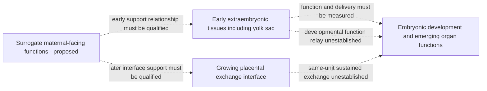

# Early support to sustained exchange: refine the missing transition

AI-assisted primary-source exploration, 2026-10-09; human scientific review
pending. This revises functional requirements, not a biological procedure,
device assembly or operating specification. Continuous human embryo-to-birth
support remains unestablished.

The preferred hypothesis remains preserving endogenous development while
supplying a surrogate maternal environment. Its early biological boundary must
explicitly include the **yolk sac and other extraembryonic tissues**, with their
changing functions and relationships to the embryo. Treating early support as
one exchange membrane would omit functions that need separate assessment.

## Three different claims to discriminate

| Claim | Observation required | Insufficient substitute |
| --- | --- | --- |
| A supportive niche helps early progression | Actual embryo-stage progression, morphology/function and complete starting-cohort outcomes against the source comparator | A vascular image or cell marker alone. |
| An interface supplies sustained exchange to the developing unit | Authenticated vascular/compartment relationships plus directed, collection-corrected delivery/removal and injury observations | Perfusable culture channels, tracer passage or an endothelial layer without a demonstrated connection to embryonic circulation. |
| Developmental functions pass between extraembryonic and embryonic tissues | Source-linked before/after functional observations, actual tissue relationships, progression and all losses in the same starting units | Cross-sectional cell-state trends, elapsed runtime or separate studies with adjoining stage labels. |

These claims can fail independently. Better early morphology does not identify
whether the benefit comes from soluble signals, mechanical context, transport
or a combination. A connected route also needs function and development.

## What the inspected primary sources establish

[Goh et al., Science (2023)](https://doi.org/10.1126/science.add7564)
provides a human yolk-sac multiomic reference and describes metabolic,
coagulation, vascular and hematopoietic roles and their relationship to developing
embryonic organs. Its data include paired tissue sampling, not a longitudinal
ex-utero support demonstration. Protein/transcript evidence and the authors'
functional interpretation remain distinct from measured transport rates or
demonstrated preservation by a machine.

[Xu et al., Stem Cell Research & Therapy (2023)](https://link.springer.com/article/10.1186/s13287-023-03583-2)
reports early mouse development with human-origin supportive vascular cells.
The organism remains mouse. The source reports seven implanted embryos among
fifteen transferred in the cell-supported group at the early uterine assessment,
versus none among fifteen controls, but no surviving fetuses at a later reported
assessment. Return to a uterus is part of this branch. No qualified connected
embryonic perfusion route or complete ex-utero gestation is established here.

The source's Results says 5.5 days of culture and 14 days after transfer; its
Discussion instead describes 48 hours to E5.5, and Figure 5's caption gives a
19-day later assessment. These locators are retained for reconciliation, not
silently normalized. Individual-unit links between endpoint assessments remain
unqualified. The reported adverse endpoint does not identify its cause.

[The 2025 human trophoblast/endothelial organoid system](https://www.nature.com/articles/s42003-025-08057-0)
reports baseline organoid growth/viability and differentiation in an endothelial
niche. It is a tissue-model component result, not embryo support or a demonstrated
fetal circulatory connection. Its infection experiments are outside this
transition case; no experimental methods are copied here.

All three source scopes are separate. Human support-cell origin does not make
a mouse embryo result human; human organoid behavior does not establish an
embryonic transition. None is promoted into the reviewed gestation ledger.

## Refine the hybrid architecture

Machine A should own continuity of the embryo and its relevant extraembryonic
tissues, compartments and emerging relationships. Machine B should distinguish
four observation obligations:

- **Early provision and processing:** delivery to the relevant extraembryonic
  compartment, its handling of supplied material and the embryo's actual receipt.
- **Emerging exchange route:** anatomical identity/continuity, directed exchange,
  storage/conversion and unintended passage, with measured input/collection.
- **Developmental function relay:** changing tissue production, metabolism and
  functional contribution, separately from marker identity or abundance.
- **Developmental potential:** linked organ/lineage progression, adverse findings,
  losses and later outcomes, including failures after apparently successful
  early endpoints.

This is a hypothesis about what must be preserved and observed. It does not
assume an artificial yolk sac can be made, prescribe cell combinations or specify
when support should switch. A stage change should be evidenced by the relevant
function and development, not inferred from a calendar.

These are functional dependencies, not anatomical claims for every species or
physical plumbing. Early and later routes may overlap; a single switch or a
fixed topology is not assumed.

## Which route merits priority?

| Research route | Current design decision | Main discriminator |
| --- | --- | --- |
| Preserve endogenous extraembryonic development with a maternal surrogate | Preferred hypothesis, because multiple changing functions would otherwise need replacement | Linked function, stage progression and losses across the early-to-sustained-exchange boundary. |
| Add a preformed vascular niche as a component | Keep as a comparator for niche support; do not count it as a completed placental connection | Distinguish supportive-cell effects from actual connected exchange and durable developmental potential. |
| Replace early support with a synthetic exchange barrier | Keep as a narrower component comparator | Show that exchange matching also preserves the relevant processing, signaling and developmental functions. |
| Use a later fetal-support interface from the starting embryo | Starting-stage compatibility is unestablished | Demonstrate the missing earlier interface formation and same-unit continuity; later fetal-support evidence cannot supply it. |

The decision favors preserving functions whose replacements are not identified.
It does not establish that the maternal surrogate or the growing interface is
implementable. A negative comparison can reject a specific architecture without
settling complete ectogenesis.

## Next concrete source and analysis requirements

The human reference offers raw/processed data for comparison of cell states and
paired tissues. Its portal recommends archived analysis code for formal work;
no author code, model or raw sequencing analysis was executed here. The paper
lists E-MTAB-10552, E-MTAB-11673, E-MTAB-10888, E-MTAB-11549, E-MTAB-11618 and
E-MTAB-11613. Repository pages were reached but their study bodies did not load
through the text tool; individual file inventories, reuse and sample mappings
remain unqualified.

For the mouse candidate, obtain/reconcile the actual embryo/run/recipient
hierarchy, stage-versus-culture timing, assessment windows and starting/endpoint
rosters before estimating transition outcomes. In-utero rescue and ex-utero
continuity must remain separate branches. Require evidence for actual connected
exchange before calling a supportive vascular niche an artificial placenta.

A future reference comparison could assess whether an interface model retains
stage-appropriate extraembryonic cell states and tissue relationships. That
comparison must keep functional assays separate and retain sampling/modality
differences. It would not alone qualify support or prove a successful function
relay.

The [source inventory](config/source_inventories/early_exchange_transition_2026.json)
records exact local snapshot hashes, publication scopes and unresolved claims.
Raw source text remains ignored/external; these are retrieval fingerprints,
not universal publisher revisions or authenticated human review.

The practical next milestone is a **same-unit functional transition dossier**:
what the early tissues do, what changes, what supplies the later function, and
whether development is preserved across that change. This narrows the feasibility
problem beyond early implantation or perfusion of a standalone tissue model.

The subsequent [functional support-route comparison](FUNCTIONAL_SUPPORT_ROUTES.md)
adds a bounded placental-bypass hypothesis and separates delivery from tissue
metabolic use. Preserve required functions without assuming one anatomical
provider must supply them throughout every interval. Same-unit development
and route-transition evidence remain necessary for either hypothesis.
