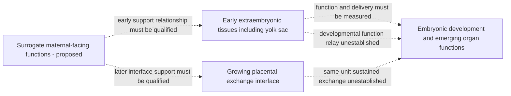

# Early support to sustained exchange: refine the missing transition

AI-assisted primary-source exploration, 2026-10-09; human scientific review
pending. This revises functional requirements, not a biological procedure,
device assembly or operating specification. Continuous human embryo-to-birth
support remains unestablished.

The preferred hypothesis remains preserving endogenous development while
supplying a surrogate maternal environment. Its early biological boundary must
explicitly include the **yolk sac and other extraembryonic tissues**, with their
changing functions and relationships to the embryo. Treating early support as
one exchange membrane would omit functions that need separate assessment.

## Three different claims to discriminate

| Claim | Observation required | Insufficient substitute |
| --- | --- | --- |
| A supportive niche helps early progression | Actual embryo-stage progression, morphology/function and complete starting-cohort outcomes against the source comparator | A vascular image or cell marker alone. |
| An interface supplies sustained exchange to the developing unit | Authenticated vascular/compartment relationships plus directed, collection-corrected delivery/removal and injury observations | Perfusable culture channels, tracer passage or an endothelial layer without a demonstrated connection to embryonic circulation. |
| Developmental functions pass between extraembryonic and embryonic tissues | Source-linked before/after functional observations, actual tissue relationships, progression and all losses in the same starting units | Cross-sectional cell-state trends, elapsed runtime or separate studies with adjoining stage labels. |

These claims can fail independently. Better early morphology does not identify
whether the benefit comes from soluble signals, mechanical context, transport
or a combination. A connected route also needs function and development.

## What the inspected primary sources establish

[Goh et al., Science (2023)](https://doi.org/10.1126/science.add7564)
provides a human yolk-sac multiomic reference and describes metabolic,
coagulation, vascular and hematopoietic roles and their relationship to developing
embryonic organs. Its data include paired tissue sampling, not a longitudinal
ex-utero support demonstration. Protein/transcript evidence and the authors'
functional interpretation remain distinct from measured transport rates or
demonstrated preservation by a machine.

[Xu et al., Stem Cell Research & Therapy (2023)](https://link.springer.com/article/10.1186/s13287-023-03583-2)
reports early mouse development with human-origin supportive vascular cells.
The organism remains mouse. The source reports seven implanted embryos among
fifteen transferred in the cell-supported group at the early uterine assessment,
versus none among fifteen controls, but no surviving fetuses at a later reported
assessment. Return to a uterus is part of this branch. No qualified connected
embryonic perfusion route or complete ex-utero gestation is established here.

The source's Results says 5.5 days of culture and 14 days after transfer; its
Discussion instead describes 48 hours to E5.5, and Figure 5's caption gives a
19-day later assessment. These locators are retained for reconciliation, not
silently normalized. Individual-unit links between endpoint assessments remain
unqualified. The reported adverse endpoint does not identify its cause.

[The 2025 human trophoblast/endothelial organoid system](https://www.nature.com/articles/s42003-025-08057-0)
reports baseline organoid growth/viability and differentiation in an endothelial
niche. It is a tissue-model component result, not embryo support or a demonstrated
fetal circulatory connection. Its infection experiments are outside this
transition case; no experimental methods are copied here.

All three source scopes are separate. Human support-cell origin does not make
a mouse embryo result human; human organoid behavior does not establish an
embryonic transition. None is promoted into the reviewed gestation ledger.

## Late-stage evidence identifies a bottleneck, not a bridge

[Aguilera-Castrejon et al. (2021)](https://www.nature.com/articles/s41586-021-03416-3)
reports an E7.5-start mouse cohort reaching approximately E11. The Results
describe approximately 77% normal development after four days across mouse
strains, followed at the late endpoint by abnormalities, interrupted yolk-sac
circulation, pericardial effusion and rapid overnight death. The authors say
this is consistent with supply no longer matching increased body size in the
absence of maternal blood supply. Figure 1d's *n* is the total embryos and *x*
the experiments; Extended Data Figure 2b further subtracts embryos dissected,
fixed or moved between conditions from the assessed total. Those summaries do
not provide a unit-linked event sequence or justify reconstructing an endpoint
survival count. See the [source qualification](AGUILERA_CASTREJON_2021_E11_HANDOFF_2026-10-10.md).

[Lokshtanov et al. (2026), bioRxiv v1](https://doi.org/10.64898/2026.03.17.710314)
describes separate mouse culture cohorts from E6.5/E7.5 through approximately
E12.5. The official [Janelia abstract](https://www.janelia.org/node/70339)
specifically claims that the E10.5–E11.5 metabolic switch is recapitulated
ex-utero, with oxygen modulating its extent but not advancing its timing. That
is a metabolism result, not proof that all development is independent of
maternal support. Selected manuscript passages report terminal adverse
findings, but exact incidence and same-unit event order remain unqualified;
the preprint is not a linked continuation of the 2021 cohort. The public
repository search surfaced no DOI-linked dataset, which leaves dataset
availability unresolved rather than proving absence.

These mouse results locate a late-development support problem, while ovine
artificial-placenta studies start from already-developed fetal lambs. The
windows are relevant to adjacent requirements but do not form one continuous
trajectory. They do not identify a single cause, prove a particular remedy,
or connect embryo-stage support to fetal support, birth or postnatal function.

## Refine the hybrid architecture

Machine A should own continuity of the embryo and its relevant extraembryonic
tissues, compartments and emerging relationships. Machine B should distinguish
four observation obligations:

- **Early provision and processing:** delivery to the relevant extraembryonic
  compartment, its handling of supplied material and the embryo's actual receipt.
- **Emerging exchange route:** anatomical identity/continuity, directed exchange,
  storage/conversion and unintended passage, with measured input/collection.
- **Developmental function relay:** changing tissue production, metabolism and
  functional contribution, separately from marker identity or abundance.
- **Developmental potential:** linked organ/lineage progression, adverse findings,
  losses and later outcomes, including failures after apparently successful
  early endpoints.

This is a hypothesis about what must be preserved and observed. It does not
assume an artificial yolk sac can be made, prescribe cell combinations or specify
when support should switch. A stage change should be evidenced by the relevant
function and development, not inferred from a calendar.

These are functional dependencies, not anatomical claims for every species or
physical plumbing. Early and later routes may overlap; a single switch or a
fixed topology is not assumed.

## Which route merits priority?

| Research route | Current design decision | Main discriminator |
| --- | --- | --- |
| Preserve endogenous extraembryonic development with a maternal surrogate | Preferred hypothesis, because multiple changing functions would otherwise need replacement | Linked function, stage progression and losses across the early-to-sustained-exchange boundary. |
| Add a preformed vascular niche as a component | Keep as a comparator for niche support; do not count it as a completed placental connection | Distinguish supportive-cell effects from actual connected exchange and durable developmental potential. |
| Replace early support with a synthetic exchange barrier | Keep as a narrower component comparator | Show that exchange matching also preserves the relevant processing, signaling and developmental functions. |
| Use a later fetal-support interface from the starting embryo | Starting-stage compatibility is unestablished | Demonstrate the missing earlier interface formation and same-unit continuity; later fetal-support evidence cannot supply it. |

The decision favors preserving functions whose replacements are not identified.
It does not establish that the maternal surrogate or the growing interface is
implementable. A negative comparison can reject a specific architecture without
settling complete ectogenesis.

## Next concrete source and analysis requirements

The human reference offers raw/processed data for comparison of cell states and
paired tissues. Its portal recommends archived analysis code for formal work;
no author code, model or raw sequencing analysis was executed here. The paper
lists E-MTAB-10552, E-MTAB-11673, E-MTAB-10888, E-MTAB-11549, E-MTAB-11618 and
E-MTAB-11613. The public BioStudies API and SDRF for E-MTAB-10552 provide a
crosswalk of 22 sample/run rows, all labelled male Carnegie stage 18, across
three source-labeled individuals (F61, F79, F80), with 18 yolk-sac and four
liver rows. Its API lists 75 files (66 raw, 7 processed, 2 MAGE-TAB); only API
metadata and the SDRF were retrieved here. These are cross-sectional tissue and
immunophenotype strata, not 22 independent embryos or an embryo-level time
series. The study-level “time series” design term does not change the common
CS18 labels.

E-MTAB-11673 adds a second metadata crosswalk: six unique samples from the
source-labeled individual F158 at female Carnegie stage 17, comprising four
yolk-sac and two yolk-sac-stalk samples. Its 18 SDRF rows repeat each sample
across three FASTQ files (I1, R1 and R2), not 18 samples. The study description
reports that yolk-sac lane WS_wEMB12142156 was excluded from downstream analysis
after cell-level QC; the processed matrices were not inspected, so that filter
is retained as a source statement. The record lists nine BioStudies files and
links an ENA project; raw-file availability through ENA was not checked.

E-MTAB-10888 adds a third crosswalk. Its 284 SDRF file rows collapse to 142
unique sample/run records for yolk-sac single-cell libraries: 71 records from
F79 labelled Carnegie stage 18 and 71 from F80 labelled stage 15. Each record
appears in two paired-end FASTQ rows (R1/R2). The F79/F80 source labels also
appear in E-MTAB-10552, but no ENA sample, BioSample or run IDs overlap. F80 is
labelled stage 18 in E-MTAB-10552 and stage 15 here; preserve the source-level
conflict without inferring a correction or paired specimens. The API lists
three processed-data and two MAGE-TAB attachments; raw FASTQ URIs appear in the
SDRF, but no reads or expression matrices were downloaded or analyzed.

E-MTAB-10888 describes yolk-sac records from F79/F80, so this intake does not
identify it as the matched coronal-section accession mentioned for F158 in
E-MTAB-11673. The three remaining accessions (E-MTAB-11549, E-MTAB-11618 and
E-MTAB-11613) are CITE-seq yolk-sac or liver datasets. Their official API and
SDRF text contains no F158 or coronal label; their sample-level crosswalk maps
11 ENA sample records across 528 runs and 1,582 file rows. Their descriptions
state 2, 3 and 6 biological replicates respectively, which are kept distinct
from file/run counts and source fields that list multiple individuals. One
E-MTAB-11618 sample has 46 index-1 rows against 48 read-1 and read-2 rows; this
asymmetry is preserved without imputing files. The initial BioStudies exact-term
screen did not surface the matched coronal accession: queries for F158, 16099
and “coronal section” returned 16/39/27 hits across all collections and 3/5/9
in ArrayExpress, with E-MTAB-11673 the only human fetal/yolk-sac record in those
results. Direct ENA Browser XML verified the existing ERP137250/PRJEB52523
project and its six sample/run records. A subsequent NCBI/ENA lookup resolved
the match as E-MTAB-11911 (PRJEB53919; ERP138734): the project title gives the
same F158/HDBR 16099 embryo, its description lists 12 coronal sections and says
the matched accession contains the yolk sac/stalk, reciprocating E-MTAB-11673.
Broader ENA Portal search calls returned errors, which do not support a global
absence claim. These metadata crosswalks do not constitute functional
observations or evidence of longitudinal support. Source-specific reuse and
analysis eligibility remain pending. Supplementary Table S6 catalogs 51
external datasets and contains no F158/16099/coronal identity. Its fetal-brain
row reports n=26, 1,665,937 cells and 3-6 PCW; the cited brain-atlas abstract
reports 5-14 PCW. The matching cell count and Linnarsson lab link lead to EGA
study EGAS00001004107, but the public sample metadata provides no source-label
crosswalk: 448 tissue-sample records contain no F158, 16099 or coronal text.
Treat that study as a candidate external reference only. Its author-provided
Table S1 joins 394 distinct sample IDs to EGA titles with matching
specimen/subject labels, but contains two duplicated sample-ID rows, 12 sample
rows absent from EGA and 28 distinct specimen labels. Two BRC2073 dorsal-midbrain
samples are listed at 6.6 weeks; they remain unlinked to F158/16099. See the
[repository intake](config/source_inventories/early_exchange_transition_2026.json),
the [22-row E-MTAB-10552 crosswalk](config/source_inventories/goh_2023_emtab10552_sdrf_crosswalk.csv),
the [six-sample E-MTAB-11673 crosswalk](config/source_inventories/goh_2023_emtab11673_sample_crosswalk.csv),
and the [142-sample E-MTAB-10888 crosswalk](config/source_inventories/goh_2023_emtab10888_sample_crosswalk.csv).
The three CITE-seq accessions are mapped in the
[remaining-accession sample crosswalk](config/source_inventories/goh_2023_remaining_citeseq_sample_crosswalk.csv).
The [brain-atlas Table S1/EGA crosswalk](config/source_inventories/goh_2023_braun_brain_table_s1_ega_crosswalk.csv)
preserves all 408 source rows and their match status, and the separate
[E-MTAB-11911 coronal-section crosswalk](config/source_inventories/goh_2023_emtab11911_coronal_sample_crosswalk.csv)
maps 48 public sample/run records across the twelve coronal-section labels
(four records per section). All 48 carry F158/female/CS17 metadata. They are
records from one embryo, not 48 independent replicates. No raw reads or
expression matrices were retrieved; the accession match does not establish
cell-level pairing or function. The project description says CellRanger count
matrices are attached with data combined across all 10x lanes, but the retrieved
project XML and ENA file reports do not expose their filenames or per-section
partitioning. The ENA run-file report lists 144 FASTQs (I1/R1/R2; 12 per
section); its analysis-file report has no rows. This does not rule out matrices
attached through another route. The
[144-row FASTQ manifest](config/source_inventories/goh_2023_emtab11911_coronal_fastq_manifest.csv)
preserves their public file metadata without downloading the files.
The 2026 [HDCA bioRxiv v2](https://www.biorxiv.org/content/10.64898/2026.03.30.714220v2.full)
lists E-MTAB-11911 for F158 and E-MTAB-11504 for F137 raw FASTQ/counts, while
reporting all listed accessions as private pending publication. Public ENA
records separately expose E-MTAB-11911 as PRJEB53919/ERP138734 with 48
sample/run records and 144 FASTQs, and E-MTAB-11504 as PRJEB51328/ERP135952
with 45 public SRA runs. Both ENA project descriptions say filtered
CellRanger count matrices are attached. However, anonymous BioStudies API
requests for all six listed ArrayExpress/BioImage Archive IDs returned HTTP
403, “Study not accessible.” Official [BioStudies access guidance](https://www.ebi.ac.uk/biostudies/RH3R/help)
says non-public studies may require credentials, but the API does not state
why these IDs were denied. The preprint may describe the BioStudies or
processed-data packages while ENA exposes linked raw reads; this route-specific
access state remains unresolved. Exact matrix links and per-section
partitioning are unverified. Exact-term SRA searches for E-MTAB-11520 and
E-MTAB-14785 returned no hits; the E-MTAB-16757 request was rate-limited. These
partial searches do not establish cross-archive privacy. No sequence or
matrix files were downloaded, and no access control was bypassed.

The public F137 project yields a metadata-only [45-row sample crosswalk](config/source_inventories/goh_2023_emtab11504_f137_sample_crosswalk.csv).
All rows link one ENA BioSample, SRA sample, experiment and run, and carry the
F137/female/Carnegie-stage-16 labels. The `fraction` field preserves all 12
coronal sections: section one has one record, and sections two through twelve
have four each. ENA metadata maps the project-described low-read lane
`WS_wEMB10202360` to section seven; retain it as a public record while
preserving the submitter's downstream-exclusion note. These rows represent one
embryo, not 45 independent units. The per-sample XML snapshots are pinned; no
reads or matrices were downloaded.

The [45-row NCBI RunInfo manifest](config/source_inventories/goh_2023_emtab11504_f137_runinfo_manifest.csv)
joins run-level spot/base counts and SRA archive download paths to these
section labels. Earlier ENA filereport attempts timed out, but a later query
using the submitted-file fields returned all 45 runs. The resulting
[135-row FASTQ manifest](config/source_inventories/goh_2023_emtab11504_f137_fastq_manifest.csv)
joins three declared I1/R1/R2 files per run to the same section labels. File
names, declared sizes and MD5 strings are archive metadata; no FASTQ contents
were downloaded or checksums recomputed. The project-described
downstream-excluded lane ERR9034751 has
133,294 spots and 16,928,338 bases, about 0.026% of the median spot count in
the other 44 public runs. This is compatible with the project's low-read note,
but remains technical sequencing metadata. No sequence or matrix data were
downloaded.

The [F137/F158 section coverage summary](config/source_inventories/goh_2023_f137_f158_coronal_run_coverage_comparison.csv)
joins 45 and 48 public RunInfo and file-manifest records to their 12-section
maps. F137 has 135 and F158 has 144 declared FASTQs. F158 RunInfo reports zero
spots/bases and no SRA
archive path for ERR9882663. A direct reconciliation found the same zero count
fields in ENA Browser XML, while the NCBI SRA package XML and ENA submitted-file
reports at both run and project levels list the same three I1/R1/R2 FASTQs,
with matching sizes and declared MD5 strings. Header-only requests returned
HTTP 200 with Content-Length matching each declared size. The pinned
[run-metadata reconciliation](artifacts/early-exchange-transition-2026-10-11/ERR9882663-run-metadata-reconciliation-2026-10-11.json)
therefore resolves file declaration and endpoint availability, but not why
the run-level counters are zero; compressed contents and checksums were not
inspected. Earlier F137 ENA requests timed out, but the later report now
permits a comparison of declared file counts and bytes across the two embryos.
File-size comparisons do not
validate read contents or measure cells or developmental outcomes. Spot/base
counts remain run-level technical metadata, not cell counts or independent
embryos.
The [93-row run/file crosscheck](config/source_inventories/goh_2023_f137_f158_run_file_crosscheck.csv)
confirms that every mapped run has one declared I1, R1 and R2 file; ERR9882663
is the only run with zero or blank RunInfo spot/base fields. This is an archive
metadata consistency check, not a read-level or biological comparison.
The preprint cross-reference does not establish functional support or a
section-specific expression matrix.
Both ENA project descriptions report combined CellRanger matrices, but the
cycle-190 analysis-file probe found no F158 analysis rows and could not retrieve
the F137 report because of endpoint errors/timeouts. The [probe receipt](artifacts/early-exchange-transition-2026-10-11/goh-f137-f158-ena-analysis-file-route-probe-cycle190.json)
records this route limitation; it does not establish that matrices are absent
or unavailable through another route. Direct matrix links and per-section
partitioning remain unresolved.

For the mouse candidate, obtain/reconcile the actual embryo/run/recipient
hierarchy, stage-versus-culture timing, assessment windows and starting/endpoint
rosters before estimating transition outcomes. In-utero rescue and ex-utero
continuity must remain separate branches. Require evidence for actual connected
exchange before calling a supportive vascular niche an artificial placenta.

At the late-organogenesis boundary, the minimum useful source record also needs
embryo and parent/litter identity; starting stage and actual stage at each
assessment; culture-day timing; status of each starting unit; observed
circulation and adverse morphology; destructive sampling, transfers and other
withdrawals with reason; and terminal disposition. Keep the molecular sampling
branch separate from embryos tracked for survival. These fields are needed to
estimate an endpoint risk set and order events; they do not prescribe an assay
or operating condition.

A future reference comparison could assess whether an interface model retains
stage-appropriate extraembryonic cell states and tissue relationships. That
comparison must keep functional assays separate and retain sampling/modality
differences. It would not alone qualify support or prove a successful function
relay.

The [source inventory](config/source_inventories/early_exchange_transition_2026.json)
records exact local snapshot hashes, publication scopes and unresolved claims.
Raw source text remains ignored/external; these are retrieval fingerprints,
not universal publisher revisions or authenticated human review.

The practical next milestone is a **same-unit functional transition dossier**:
what the early tissues do, what changes, what supplies the later function, and
whether development is preserved across that change. This narrows the feasibility
problem beyond early implantation or perfusion of a standalone tissue model.

The subsequent [functional support-route comparison](FUNCTIONAL_SUPPORT_ROUTES.md)
adds a bounded placental-bypass hypothesis and separates delivery from tissue
metabolic use. Preserve required functions without assuming one anatomical
provider must supply them throughout every interval. Same-unit development
and route-transition evidence remain necessary for either hypothesis.
