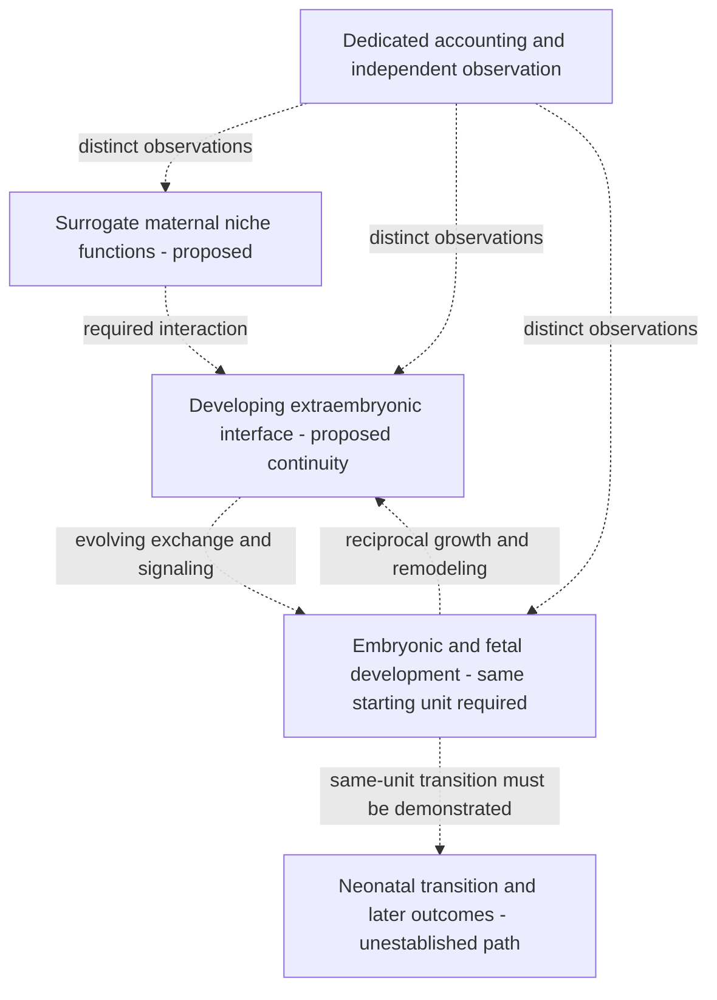

# Making the embryo-to-birth concept testable

AI-assisted design exploration, 2026-10-09. Proposed functional architecture;
human scientific review pending. Full human ectogenesis remains unestablished.
This supplies research choices and falsifiable requirements, not materials,
assembly instructions, embryo procedures or operating parameters.

The strongest route to investigate is **preserving the developing embryo and
its extraembryonic tissues while supplying a surrogate maternal environment**.
Let endogenous development organize the living interface; qualify the maternal
functions it needs and the development it actually supports. This is a design
hypothesis, not a demonstrated way to produce a healthy child.

The central missing capability is a **same-unit transition from early support
to a sustained, growing, functional exchange interface**. Longer survival or
better equipment control cannot substitute for that transition. The
[three-machine concept](SYSTEM_DESIGN.md) remains the functional frame; this
revision specifies the assumptions to test first.

The [early exchange transition](EARLY_EXCHANGE_TRANSITION.md) now specifies
which functions need continuity: early yolk-sac/extraembryonic provision and
processing, emerging connected exchange, and the relay of developmental
functions as organs develop. Require same-unit function and later outcomes.
Inspected niche evidence includes a failed later developmental endpoint after
early implantation; preserve that adverse finding and unresolved source timing.

## Choose the biological boundary before refining equipment

| Proposed allocation | Function to preserve or supply | Unresolved question |
| --- | --- | --- |
| Embryo and extraembryonic compartment | Endogenous organization, lineage progression and establishment of the fetal side of the interface | Can the actual starting unit progress with its extraembryonic tissues linked to later function? |
| Surrogate maternal niche in Machine A | Attachment, spatial context, local signaling, mechanical response and remodeling | Which maternal-facing functions are necessary at each observed stage, and can a bounded surrogate support them? |
| Growing living exchange interface in Machine A | Selective exchange, barrier function, interface metabolism and signaling while structure changes | Can it sustain delivery and clearance alongside development, distinguishing leakage and storage from delivery? |
| Support and observation in Machine B | Independently account for supplied/removed quantities, interface state and development | Do observations identify the relevant function, and distinguish equipment state from biological outcome? |
| Machine C and follow-up | Assess neonatal transition and later outcomes | Is continuity demonstrated for the same starting units, retaining losses and unavailable follow-up? |

These are functional requirements, not physical connections, blood sources,
interface materials or a clinical implementation.

This is a dependency model, not a device schematic. The living interface is
neither assumed to self-assemble correctly nor treated as a fixed membrane.

## What new evidence changes the design

[Guo et al., *3D biomimetic niche modulates embryo development in vitro*,
Nature Communications (2026)](https://www.nature.com/articles/s41467-025-68039-y)
reports mouse blastocyst progression to an E8.5-like stage, with early cardiac
activity. Figures 4–6 link niche relaxation, adhesion and remodeling to early
developmental outcomes. The discussion identifies nutrient infiltration as an
early-stage limit and says the niche cannot substitute for a placenta later.
Culture day and developmental stage remain separate.

**Design inference:** qualify time-dependent mechanics and remodeling alongside
stiffness; make sustained exchange a separate requirement. This source does
not establish a human material choice or a complete-gestation interface.
Perturbation specificity and changes in other material properties need review
before assigning one causal mechanism.

[Usuda et al., Frontiers in Physiology (2023)](https://www.frontiersin.org/journals/physiology/articles/10.3389/fphys.2023.1219185/full)
reports partial support of extremely preterm ovine fetuses for up to 336 hours
with maintained circulation but abnormal somatic/organ growth. Edema complicates
body-weight interpretation. Reduced IGF-1 is reported; the cause of impaired
growth remains unresolved and potentially multifactorial.

**Design inference:** assess organ-specific development, fluid/body-composition
state and independent function alongside support. An endocrine association
does not establish a single-hormone solution. Nutrition, signaling, stress or
exposure, and clearance explanations remain competing hypotheses.

Cycle 346 makes this constraint quantitative in a separate
[terminal group intake](config/observations/usuda_2023_terminal_group_candidate.json).
The APT/control ratios of published terminal means are 0.976 for body mass,
0.810 for lung mass, 0.704 for liver mass and 0.736 for kidney mass, while brain
mass is 1.028. These unadjusted group ratios retain all nine terminal numeric
Table 1 endpoints; they are not individual growth effects or acceptable design
margins. Complete Table 3 summaries retain competing biochemical explanations.
Differing necropsy ages, edema, the six/eight-control discrepancy, and missing
animal links prevent a causal or same-unit support/development analysis.
The machine concept must therefore preserve independent developmental and
fluid-state observations as requirements; apparently similar body mass is
insufficient evidence of developmental adequacy.

The [2026 human maternal–fetal interface atlas](https://www.nature.com/articles/s41586-026-10316-x)
adds spatially distinct maternal/fetal states and remodeling context. It is a
comparison reference, not proof that a cell-state list supplies support.
[Human implantation](INTERFACE_FEASIBILITY.md) and
[ovine partial-support evidence](https://www.nature.com/articles/ncomms15112)
address separate intervals; these studies cannot be joined into a demonstrated
human path.

## Keep competing architectures testable

The [functional support routes](FUNCTIONAL_SUPPORT_ROUTES.md) add a bounded
placental-bypass comparator, informed by a 2026 mouse preprint that reports
whole-embryo culture through approximately E12.5 while also reporting low
terminal morphological yield and adverse findings. It tests which
maternal/placental functions are necessary over a declared interval.
The growing biological interface remains the preferred full-course hypothesis;
neither route is established for complete human gestation. Delivery, tissue
metabolic use and organ/lineage development need separate observations.

| Alternative | Why retain it | Evidence against using it as the main architecture |
| --- | --- | --- |
| Fixed niche and fixed support | Simple reference for a narrow interval | Progression stalls or function changes despite matched fixed properties. |
| Fixed artificial exchange barrier | Component reference for a qualified transport question | Matched exchange endpoints coexist with impaired development or signaling. |
| Growing hybrid biological interface | Preserves more endogenous functions; preferred research hypothesis | Interface growth/function cannot be sustained, maternal interaction fails, or adverse outcomes exceed the comparator. |
| Bounded placental bypass retaining relevant embryo/extraembryonic tissues | Tests functional support without assuming every maternal anatomical relationship is necessary in that interval | Delivery, metabolic use or development fails; extension or route transition loses continuity. |
| Stage-separated units | Allows separate stage questions | Transfers fail continuity or endpoint survivors conceal transition losses. |

The hybrid hypothesis does not establish that all maternal functions can be
supplied externally. Synthetic replacement remains a comparator, with the
additional burden of showing that omitted living interactions are dispensable
for the declared interval and outcome.

## Reduce uncertainties in this order

1. **Early niche function.** Review existing links between mechanical response,
   remodeling and progression. Compare a stiffness-only explanation with
   time-dependent response, retaining chemistry, architecture and transport as
   possible confounds. Use actual embryo/run hierarchy and the starting roster.
2. **Early-to-sustained-exchange boundary.** Require interface organization,
   directed exchange and development in the same unit across that boundary.
   A heart-like structure, endothelial marker or visible vessel does not
   establish a working exchange circuit.
3. **Support versus development.** Link support records to growth, organ
   development, injury and losses in actual units against the declared reference.
   Separate edema, storage and input/collection changes from growth/delivery.
4. **Extend only demonstrated continuity.** Keep developmental maturity separate
   from elapsed time. Require same-unit later support, neonatal transition and
   follow-up before extending claims.

These are analysis/evidence milestones, not embryo or animal procedures.
Existing data can contradict an architectural assumption before a physical
implementation is proposed. New biological work would require independent
specialist design/review; this project supplies no procedure or settings.

## Acceptance and failure conditions

| Question | Evidence needed to advance | Result that leaves or increases the gap |
| --- | --- | --- |
| Progression rather than attachment alone? | Starting-cohort, source-staged progression and functional endpoints with comparators | Better attachment/markers with impaired progression or unknown attrition denominator. |
| Support scaling with the interface? | Linked structure, net delivery/removal, injury and development across changing stages | Passage caused by barrier failure, capacity inferred from geometry alone, or development lag despite stable support. |
| Similar interface function and development? | Independently measured exchange/signaling and organ/lineage outcomes in linked units | Matched transport or identity with adverse developmental findings. |
| Compatible changes of support? | Unit identity, actual before/after state, transition losses and outcomes | Unrecorded transfers, selected survivors or stages inferred from runtime. |
| Complete path with assessed health? | Same-unit start-to-neonatal records and cohort-wide follow-up | Survival-only ascertainment, missing later outcomes or disconnected studies/species. |

Requirements must remain simultaneous and stage-specific. No scalar or readiness
percentage establishes full-system success. Biological thresholds require a
reviewed model/data contract; unknown quantities stay unknown.

## Immediate empirical target and limits

Guo's publisher workbook is now inspected in the
[niche-source qualification](NICHE_SOURCE_QUALIFICATION.md). An executable audit
preserves selected mechanical/profile cells and candidate developmental
percentages, while retaining unknown cross-panel unit links and denominators.
The article declares CC BY-NC-ND 4.0; workbook-specific reuse terms remain
unqualified. Figure 4 axes, Methods, and Supplementary Fig. 10I now qualify
panel-specific units, rheometer profile time/response axes, normalization and
parts of the loading history. The Figure 4C modulus protocol mapping,
mechanical specimen/run and profile-to-summary hierarchy, material-to-embryo
links, outcome numerators/denominators and exclusions remain open.
The source workbook also repeats five exact numeric lexemes between the Fig4A
and Fig4D 40-MG columns (six cells in Fig4A because one lexeme occurs twice;
five cells in Fig4D). With no sample/run IDs, this cannot establish whether the
entries are shared, remeasured, reused or coincident, and they must not be
joined or counted as independent replication.
Supplementary Fig. 10J's `Sup10J` sheet provides three half-time values per
condition, consistent in count with its n=3 independent-experiment caption;
their reconstructed means and sample SDs match the plotted summary scale.
There are no experiment IDs or links from these values to the Sup 10 I curves.
However, the 40-MG half-time cells reveal an unresolved panel-scale gap:
Figure 4A and 4D source values span 5.834–12.986 s, while Sup. Fig. 10J
values span 75.018–80.019 s. Their means differ by about eightfold. Fig. 4D
names nanoindentation and Fig. 10J names a rheometer. A recheck of the pinned
article's Figure 4A caption and Results paragraph found no assay or instrument
assignment for that panel. Resolve protocol and
run/sample hierarchy before comparing or pooling these panels; the difference
is a source-reconciliation flag, not a direct contradiction. The pinned HTML
snapshot and reviewed section locators are now hash-recorded in the audit.
As a separate source-level check, the normalized Sup 10 I curves first cross
0.5 between adjacent coordinates at 80.018–85.020 s (40-MG), 145.035–150.036 s
(40-MGT), and 160.038–165.041 s (40-MGN). The Sup10J source-cell means are
78.352, 145.035, and 150.037 s, each within 10.001 s of its profile bracket.
This supports broad timescale consistency between Supplementary panels I/J,
but profile aggregation and experiment mapping remain unknown; no values are
interpolated or pooled.
This could discriminate a fixed-stiffness niche assumption without claiming
later support. Usuda's raw-data statement offers author-provided data; a linked
support/growth comparison still needs unit records and comparator reconciliation.

Local HTML snapshots and hashes appear in the
[candidate inventory](config/source_inventories/growing_interface_2026.json).
They identify local retrievals, not universal publisher revisions. Methods
remain external/ignored. New sources are candidates, separate from the reviewed
evidence ledger.

The current Kelvin–Voigt fixture models strain response under imposed stress.
It does not reproduce finite stress relaxation under held strain. Its response
time is not a published relaxation half-time, and its parameters are not
calibrated by this paper. A mechanics comparison needs the actual loading and
measurement history plus a reviewed model class.

The resulting research direction is a remodelable maternal niche and a growing
living interface, assessed through joint support and development. Whether it
can deliver complete human embryo-to-birth support remains an open question.

The [moving-boundary qualification](DYNAMIC_BOUNDARY_REQUIREMENTS.md) now makes
this requirement more specific. Comparative early mouse evidence connects
embryonic growth with extraembryonic boundary movement; it does not establish
later exchange or identify the cause of arrest in another study. Require linked
growth, boundary and outcome trajectories before reanalysis, and independent
support receipt/function before claiming coordination failure despite adequate
support. Public segmentation annotations currently qualify a measurement resource,
without supplying that joint biological endpoint.

## Select work by the uncertainty it can change

The 2026-10-11 gas-reference branch has reached diminishing returns: several primary abstracts independently report age trends, but the reviewed routes do not supply the required numeric 24-/28-week values. Hold additional trend-only intake until an exact table, numeric regression or eligible dataset appears. The source arithmetic audit remains useful; it does not resolve this physiological applicability gap.

The late-support/transition evidence comparison is already recorded in Cycles 310–315. Repeating that comparison would not close the early-to-sustained-exchange boundary. Prefer an analysis with usable quantity/unit linkage and a stated counterexample to the chosen architecture, or a source that resolves an actual same-unit handoff. A demonstrated intake defect also warrants a bounded fix: Cycle 345 preserves partial source ages without inferring missing bounds. These are distinct advances in evidence handling, model applicability and biology; count them separately.
