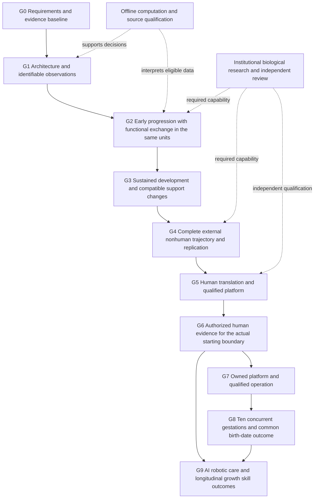
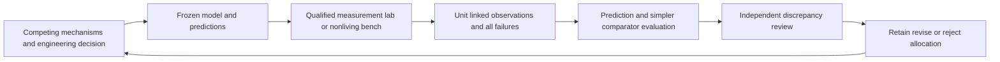

# Completion program for owned ectogenesis equipment and ten concurrent gestations

Version 4 dated 11 October 2026. Owner directed, AI assisted research and engineering planning. Prioritizes the earliest achievable outcome, preferably within two to three years, and removes avoidable planning dependencies. Scientific and clinical review remain separate from this document.

## Purpose and decision

The required outcome is **owned equipment supporting at least ten simultaneous human gestations from embryos supplied upstream, without human surrogates, with ten children's births on the same calendar date**, independently assessed development and continuing health follow-up. AI and robots are intended to contribute materially to operation, raising, education and parenting. The owner additionally wants physically tall children with strong intellectual and practical skills. These are explicit downstream growth and capability objectives, not presumed outputs of a gestation chamber.

Assume **100 or more embryos are available upstream**, fresh, cryopreserved or otherwise preserved with source-defined records. Embryo acquisition is not the current bottleneck or workstream. The unresolved early capability is the machine's ability to support development from an embryo into a sustained functional support relationship. It does not mean an embryo is missing. Inventory size alone establishes neither suitability nor the number or timing of successful outcomes.

This is a **completion program**: discoveries, owned system construction by specialists, qualification, concurrent operation and parenting capabilities must each reach their stated acceptance conditions. A service-only route, sequential births, more reports or passing software tests cannot satisfy the final objective. Each failed technical approach triggers a specific redesign, discriminating measurement or replacement approach.

The owner prefers **owned equipment and the ten-concurrent, common-date birth outcome as soon as achievable, ideally within two to three years or less**: 11 October 2028 to 11 October 2029 from the original planning date. Use 11 October 2029 as the preferred outer planning target and pursue earlier completion. Five years is a comparison scenario; ten years may be tolerable to the owner, not an instruction to spread work over ten years. None is a supported completion forecast. The actual shared birth date is unselected. Longitudinal health, tall stature and later intellectual/practical skills remain required outcomes assessed at relevant ages after birth.

The requested **100% success guarantee is unsupported**, including over five years or an unspecified eventual horizon. An embryo stock, repeated attempts or a finite test series cannot establish guaranteed completion, health, date alignment, stature or intellectual outcomes. More time permits more work but does not establish that the required discoveries will occur. Completion of the ten-child objective and the success rate across all starting embryos are separate quantities; record both without counting only successful cases. Completion targets remain firm; unresolved science remains explicit.

Country and cash budget remain undecided; the earliest-outcome preference now constrains planning. Use current resources for the first phase; prepare concrete equipment, laboratory and staffing commitments before spending. Collaboration, component purchases and technology licensing are means to deliver owned equipment, not alternate definitions of success. Religious and political argument is outside this technical workstream. Applicable laboratory and human-use requirements are an execution track handled alongside scientific work, not the program's purpose. The standing instruction remains **no author contact**; sending any prepared packet requires a separate instruction.

## How to use this document

This is the master strategy. [The program register](config/program/roadmap.json) holds stable requirement, gate, task and uncertainty IDs. [The progress view](PROGRAM_STATUS.md) is generated from that register and checks referenced local evidence. [The detailed implementation history](ROADMAP.md), [research contracts](RESEARCH_PROGRAM.md) and [functional machine concept](SYSTEM_DESIGN.md) remain supporting records.

The current early-support decision is recorded in [Early-support architecture and observation decision](EARLY_SUPPORT_LINKAGE_DECISION_2026-10-11.md). It compares living-interface, staged and synthetic allocations against same-unit delivery, tissue-use and developmental-progression observations, then records the eligibility and measurement-data contract used for T01, T02, T04 and T16. The [source challenge](EARLY_SUPPORT_SOURCE_CHALLENGE_2026-10-11.md) revises the LIPT1 interpretation and keeps the independent-review task held. The [owned-platform options worksheet](OWNED_PLATFORM_OPTIONS_2026-10-11.md) compares owner-led, acquisition/licensing and co-development routes with explicit ownership conditions, resource unknowns and decision windows.

At the beginning of each work cycle, inspect the register and relevant existing artifacts. At the end, record the result against the original acceptance conditions, update the uncertainty and decision, and regenerate the progress view. Revise this plan only when evidence, owner constraints or a substantive strategic decision changes. Preserve prior artifacts rather than overwriting them.

The first baseline credits actual completed work as software or evidence curation. It gives no biological gate credit for those achievements. Unknown or adverse results remain visible. A software task can be complete while its associated biological gate remains open.

## Define the machine outcome

The starting boundary is a source-defined embryo supplied upstream; assume the available pool contains 100 or more embryos. Record starting stage, preservation/history and unit identity when actual inputs are selected. Fresh and preserved inputs are not silently treated as equivalent. The main route must not depend on prior gestation in a human surrogate. Starting with an already developed fetus is a useful component precedent, but cannot satisfy the embryo-to-birth requirement. Fertilization, preservation and donor procedures are outside this engineering document.

Donor gametes remain the baseline upstream source. Synthetic gametes are a separate research branch and are not required to make the machine. This plan treats embryos as available inputs, not a procurement campaign.

| ID | Required outcome | Evidence that can establish it |
| --- | --- | --- |
| R01 | No human surrogate gestation from the declared starting boundary | Documented starting state, prior history and complete external trajectory |
| R02 | Identity and coverage of every starting unit | Source identities, disposition roster, losses and missing follow-up |
| R03 | Appropriate early organization and progression | Stage-defined embryonic and extraembryonic observations with comparators |
| R04 | Adequate support functions as development proceeds | Linked exchange, barrier, metabolism and signaling observations over changing stages; a growing living interface is specific to the hybrid hypothesis |
| R05 | Sustained organ development alongside support | Independent organ/lineage development, injury and function assessments |
| R06 | Compatible support changes and any handoffs | Same-unit before/after observations, timing and transition losses |
| R07 | Transition to neonatal life | Defined neonatal function and care needs, adverse events and ascertainment windows |
| R08 | Reproducible outcomes and continuing health assessment | Complete-cohort follow-up, independent replication and unresolved risks |
| R09 | A technically and clinically qualified human route | Independent platform, medical and actual intended-use decisions, with execution requirements handled in parallel |
| R10 | Complete owner-specific outcome | Owned equipment, ten concurrent gestations, common actual birth date, continuing health and separately assessed care/development |
| R11 | Owned, maintainable equipment | Ownership/control, maintainable specifications, configuration rights, parts, operators and continuing support |
| R12 | At least ten simultaneous gestations | Independently identified concurrent trajectories; shared-resource, isolation and neonatal-capacity evidence |
| R13 | Common calendar birth date | Defined qualifying event, time zone, actual timestamps and independent readiness; date misses remain visible |
| R14 | At least 100 upstream embryos assumed available | Owner premise recorded separately from verified inventory, suitability and resulting outcomes |
| R15 | AI/robot-assisted parenting and development | Qualified assistance tasks, human responsibility and fallbacks, tall-stature preference, intellectual/skill goals and longitudinal outcomes |

“Healthy” is not a single machine-exit score. Assess neonatal physiology, anatomy, growth, neurological development, other organ function and later outcomes at stated ages. Some outcomes require years; no finite examination guarantees lifetime health. Statistical acceptance margins, clinical study sizes and biological operating conditions must be established by qualified specialists, not invented by an agent or inferred from toy models.

The same-date requirement is assessed from actual outcomes, not common start times or synchronized software clocks. Specify the event and calendar/time zone before evaluating it; a machine transition timestamp is not automatically the formal birth record. Each unit needs independent developmental-readiness evidence. If ten units cannot meet both development and date conditions, this requirement is unmet; do not redefine sequential success or an imposed calendar as completion.

## The critical path

The arrows are evidence dependencies, not a device assembly diagram. Qualification and execution planning run in parallel; their completion cannot be assumed. Care/robotics preparation also starts in parallel, but real-child outcomes depend on the later human route. Nonhuman findings inform translation; they do not establish human equivalence. No source from one species or interval fills an unproven transition in another.

| Gate | Advance condition | Hold or reject condition | Present assessment |
| --- | --- | --- | --- |
| G0 | Traceable requirements, starting boundary, known achievements and resource assumptions | Unspecified outcome or no distinction between code and biology | Baseline defined; constraints undecided |
| G1 | Competing allocations, distinguishing observations and a reviewed eligible analysis contract | Unidentifiable models or architectural preference without an empirical discriminator | Architecture remains a hypothesis |
| G2 | Same units show early progression and sustained functional exchange, with adverse findings and starting coverage | Attachment, vessel appearance or molecular markers alone | Not established for the target path |
| G3 | Exchange and stage-appropriate development persist together; support changes retain continuity | Stable circulation or body mass with impaired organ development | Target continuity not established |
| G4 | Complete external nonhuman trajectory from the relevant starting boundary, losses and follow-up, independently reproduced | Selected survivors or a path assembled from separate studies | Not established by the reviewed evidence |
| G5 | Qualified platform, independent human-translation review and actual intended-use execution pathway | Partial-support discussion substituted for complete-gestation qualification | Platform and route unresolved |
| G6 | Authorized human evidence covers the declared entry, transitions and outcomes | Animal results, proposed trials or announcements substituted for human results | Not established |
| G7 | Owned equipment with maintainable configuration, qualified operators, continuity and independent outcome ascertainment | Ownership without dependable function or a service-only substitution | Not established |
| G8 | Ten concurrent gestations, actual common-date births, independent developmental readiness and shared-failure qualification | Sequential success, clock alignment or ten copied devices treated as the target outcome | Not established |
| G9 | Qualified AI/robot assistance and observed longitudinal growth/learning/skills in the intended setting | Task demos, simulated learners or newborn outcomes treated as dependable parenting or later capabilities | Preparation possible; real outcomes unestablished |

Relevant partial-support precedent includes [Partridge et al. 2017](https://pmc.ncbi.nlm.nih.gov/articles/PMC5414058/), while [human implantation morphogenesis](https://doi.org/10.1038/ncb3347) concerns an earlier, separate interval. These motivate specific functions and measurements; they do not constitute a complete human trajectory.

## Compare routes before committing to one

Avoiding a living human surrogate does not imply replacing every biological interaction with a synthetic component. The preferred hypothesis remains preservation of endogenous embryonic and extraembryonic development with an engineered maternal-facing environment. Its preference must earn support from comparative evidence.

| Route | Why examine it | Principal burden | Current decision |
| --- | --- | --- | --- |
| Continuous habitat with a growing hybrid living interface | Could preserve developmental relationships while external support changes | Remodeling, exchange, signaling and development must remain compatible | Lead hypothesis, not selected implementation |
| Stage-specific habitats with qualified handoffs | May simplify individual stage questions | Every handoff adds a continuity and loss boundary | Retain comparator |
| More synthetic functional replacement | Could make some component quantities easier to control and account for | Identify omitted biological functions and show their omission is compatible with development | Retain comparator |
| Ex vivo maternal tissue or organ-supported interface | May preserve otherwise missing maternal interactions | Source qualification, viability, support burden and practical availability | Research comparator only |

Choose between owner-led development with a specialist team, acquisition/licensing of qualified components into an owned platform, and jointly developed equipment with explicit ownership/control rights. A collaborator or laboratory can supply capabilities while the equipment objective remains ownership. Purchasing a service is not equivalent completion. The current computer resources supply analysis and software; wet-lab measurement, physical construction, metrology and operator capability must be acquired or developed as named resources.

Architecture downselection must state which prediction distinguishes the routes, which quantity observes it, and what result would change our preference. If available data cannot distinguish the predictions, record non-identification and the minimum additional observation. Do not resolve the ambiguity by making the simulation more elaborate.

## Turn the architecture into a machine program

The current concept allocates **A: an individual gestation unit**, **B: its support and independent observation station**, and **C: a separately qualified neonatal transition station**. A owns the biological boundary and identity; B supplies and verifies the allocated support functions; C owns the transition assessment and subsequent care interface. These allocations must survive T01 before they become implementation commitments. See [the functional diagram and alternatives](SYSTEM_DESIGN.md).

The following work packages give a specialist team concrete engineering deliverables. They are deferred implementation milestones, not tasks for immediate hardware construction. Requirements preparation and data review can precede biological success; physical scope must be justified by qualified requirements and an accountable research operation. Equipment ownership remains the owner's objective.

| Milestone | Accountable capability | Deliverable | Acceptance and dependency |
| --- | --- | --- | --- |
| M12 Functional allocation review | Developmental/placental biology and systems engineering | Requirement-to-function matrix for A/B/C and alternatives, omitted functions and boundary assumptions | Specialist review of T01; each function has an observable and a consequence if absent |
| M13 Candidate interface qualification | Interface biology and quantitative measurement | Evidence linking component function to progression in the same source-defined units | G2 observations; component transport or morphology alone cannot satisfy developmental adequacy |
| M14 Observation qualification | Metrology, imaging/data expertise and independent methods review | Measurement dictionary, identity/time joins, calibration traceability, uncertainty and failure-detection evaluation | Relevant ranges and references established by specialists; independent checks distinguish observation failure from biological change |
| M15 Resource continuity and isolation | Reliability and systems engineering | Fault/dependency register and component verification evidence for resource continuity, containment and unit isolation | Requirements from M12/M13; component and offline fault results remain separate from biological outcomes |
| M16 Integrated platform verification | Systems integration and accountable research operations | Traceable requirement/test matrix, configuration control and evidence of compatible support changes | M13–M15 plus same-unit G3 outcomes; a successful bench run cannot substitute for sustained development |
| M17 Manufacturing and owned-operation qualification | Quality/manufacturing, sponsor and clinical operations | Reproducibility, maintainability, responsibility and facility-continuity qualification package | G5 actual intended-use review; qualified process and independent decisions before human clinical deployment |
| M18 Transition and follow-up contract | Neonatal/pediatric expertise and outcome methods | Starting-cohort disposition, transition outcome definitions, additional-care recording and continuing ascertainment contract | Required before complete-trajectory outcome claims; methods and windows set by qualified specialists |

Each package must specify its input contract, responsible role, exact evidence, independent reviewer and next decision. The project can contribute source qualification, traceable software and bounded analysis. A biological interface team, measurement capability, accountable institution and eventual clinical sponsor remain resources to obtain; they are not supplied by additional agent runtime.

## The computer, laboratory and physical engineering loop

Biological discovery is part of the program, not something to wait for passively. Use a repeated **hypothesis → frozen prediction → qualified observation → comparison → redesign** loop. Each iteration is an independently resumable job with an actual decision at its end. Laboratory and physical work feed back into the same evidence register; AI prepares the next discriminating question and analysis. The specific biological study or assay must be supplied and reviewed by the responsible research team rather than invented as operating instructions in this repository.

| Step | Required work product | Completion test |
| --- | --- | --- |
| Define | Competing explanations, missing function and a falsifier | Distinct possible observations change the allocation or next measurement |
| Qualify | Quantity, calibration, identity/time mapping, stage, uncertainty, missingness and comparator contract | Observation failure can be distinguished from biological change |
| Freeze | Input/code/configuration snapshot, simpler comparator and withheld prediction targets | Predictions precede the evaluated observations; an already-inspected retrospective replay is labeled accordingly |
| Measure | Existing eligible source data, nonliving bench observations or referenced reviewed biological research | Actual data satisfy the contract; retain every starting unit and adverse finding |
| Compare | Reproducible residuals, uncertainty and failures against the simpler comparator | Failed predictions are exposed instead of absorbed into extra parameters |
| Challenge | Independent source, metrology and model review | Classify discrepancy as measurement error, model error, allocation failure or unresolved |
| Redesign | Retain/revise/reject decision and precise next experiment/measurement question | Next iteration closes a real ambiguity; do not repeat the same missing-data finding |

Start with **T16**: inventory real feedback resources and define the first executable iteration. Record available computers, measurement-file formats, instruments/facilities, software exports, specialist roles and resources not yet acquired. Replay one existing eligible data path to establish identity, clocks and auditability. A replay checks the pipeline; it is not a new biological discovery or blind prediction. Use a nonliving bench only for a specific justified metrology/resource question. Then prepare a reviewed prospective biological question with the required measurements and analysis, followed by actual results and model revision when that capability exists.

A prediction that fails withheld observations requires investigating its applicability and assumptions. If transport appears adequate while development is impaired, first examine measurement validity, embryo/preservation differences, comparator confounds and omitted functions. Developmental failure prevents completion but does not by itself identify the cause. Revise or replace the support allocation when discriminating evidence warrants it. If two architectures remain observationally indistinguishable, obtain the discriminating measurement instead of choosing by simulation detail. These are concrete redesign triggers.

## Ownership, ten-unit operation and AI/robot parenting

Design the ten-unit architecture alongside single-unit research. Record which resources are dedicated and shared, identity/configuration routing, interruption recovery, correlated failures and ten simultaneous neonatal-transition demands. **M19/T13** compare isolated and shared allocations using existing bounded offline fault tools and later qualified nonliving measurements. Unknown physiological loads remain unknown; digital/bench capacity is engineering evidence only. Demonstrating one unit is a development dependency, not completion of ten simultaneous gestations.

**M20/T14** define the same-date outcome, its time zone and qualifying event, source-qualified timing variability and observations of independent readiness. A common start or scheduling software cannot establish the outcome. Record mismatch and target misses; retain this as an explicit completion requirement.

**M21/T15/G9** develop AI/robot parenting as its own capability program. Separate administration, housekeeping, education and potential physical care functions. For each, name the operating domain, task inputs, responsible person, failure detection, fallback, independent review and evidence needed before authority expands. Test simulations and nonliving tasks first; then evaluate only capabilities qualified for their real setting. Measure end-to-end completion and recovery under interruptions, rather than only successful subtasks. Ten children create competing demands, so include ten-client task routing, supervision availability and shared failures.

Primary evidence supports bounded capability evaluation. The [BEHAVIOR Robot Suite paper](https://arxiv.org/html/2503.05652v2) evaluates household tasks and documents long-task and perception limitations; it does not evaluate parenting. A [2025 AI-tutoring study](https://www.nature.com/articles/s41598-025-97652-6) measures immediate learning in undergraduate physics with a deliberately structured tutor. It does not establish early-childhood intellectual outcomes. We infer that task-specific qualification and independent learning measures are necessary; neither paper validates this proposed parenting system.

For intellectual and practical skills, define age-appropriate goals, independently checked instructional content, unaided performance, delayed retention, transfer and real skill execution. For tall physical stature, specify the relevant ages and growth outcome separately from birth size. Desired stature and abilities are longitudinal outcomes to measure, not quantities established by embryo stock or machine telemetry. Preserve developmental health and record whether the specific preferences are actually met.

## What has actually been achieved

| Contribution | Authoritative artifact | Credit allowed | Remaining gap |
| --- | --- | --- | --- |
| Functional machine allocation and transition map | SYSTEM_DESIGN.md and RESEARCH_PROGRAM.md | Requirements and architecture hypotheses | Physical and biological implementation |
| Typed observation intake and source-scope repair | Cycle 345 report and source code | Verified software handling of known and unknown bounds | Biological validity and source review |
| Source arithmetic and quantitative constraints | Cycles 335 and 337 primary-source audits | Recovered values and reproduced published calculations | Applicability as human requirements |
| Late-support continuity and endpoint classification | Cycles 310 to 315 | Existing evidence gaps and classifications | All-start same-unit developmental chain |
| Support versus development challenge | Cycle 346 source audit and validated terminal intake | 59 numeric group summaries and one missing cell | Individual links, causal interpretation and later health |
| Dimensionless simulations and verification | Existing bounded model commands and tests | Software behavior within the declared fixture domain | Physiological calibration and independent empirical validation |

The Cycle 346 arithmetic illustrates the design problem: published APT/control means are approximately 0.976 for body mass, 0.810 for lung mass, 0.704 for liver mass and 0.736 for kidney mass; brain mass is 1.028. These unadjusted group ratios preserve differences in necropsy ages, edema, the control-count discrepancy and absent animal links. They require independent developmental observations alongside circulation and weight; they do not select a hormone, nutrient or device correction. [Primary article](https://doi.org/10.3389/fphys.2023.1219185), [source audit](artifacts/usuda-terminal-development-cycle346/source-audit/REPORT.md).

The current inspected candidates do not supply an eligible complete-gestation biological benchmark or an independently evaluable dynamic model of the critical early transition. Descriptive reproduction is useful within its source scope. Dimensional fitting remains conditional on actual quantities, units, clocks, calibration, accounting and unit hierarchy.

## The next ninety days

These are targets for work products, not promises that biological gates will pass on a calendar. If a dependency is unavailable, complete the rejection decision and move to another eligible task. The register contains the acceptance conditions and timeboxes.

### First two days: start three complementary workstreams

Start T01 architecture comparison, T16 measurement/capability inventory and T08 owned-platform/resource options together. Each produces a bounded artifact; no extra program or dashboard is required. Keep at most these three active workstreams until one finishes or is held. One integrator edits; read-only workers can investigate independent inputs. Biological qualification, metrology, engineering, resources and care preparation can overlap where their inputs permit it; their outcome acceptance conditions remain distinct.

T08 no longer waits for T06's finished packet or T07's compute calibration. It may document unknown costs and missing capabilities, compare ownership arrangements and prepare a concrete resource choice immediately. A draft resource worksheet is not a purchase decision or a completed laboratory capability. Update it when T16 and reviewed scientific results supply qualified requirements.

The first discriminating question is whether observations can distinguish **delivery to the recipient, use of what is delivered, and developmental progression in the same identified units**. The existing [early-transition assessment](EARLY_EXCHANGE_TRANSITION.md) and [support-function comparison](FUNCTIONAL_SUPPORT_ROUTES.md) already explain why late-fetal exchange evidence does not establish embryo-entry support and why transfer alone is insufficient. T01 must identify the actual observation/capability that could change the functional allocation; repeating that conclusion in another architecture table is not progress. These records do not yet select a full living interface over a bounded alternative. T16 should establish whether the required observation path is available or specify exactly what capability is missing.

### By day seven: decide the first question

1. **M01 Program baseline.** Deliver this plan, the register, a generated status view and stable uncertainty IDs. Verify every cited completed artifact. Acceptance: the biological gates remain open; completed software/source work has explicit scope.
2. **T01 Architecture decision contract.** Reuse the existing system design and source inventories to map the functions at the early-to-sustained-exchange boundary. Compare the existing architecture tables and name what the new contract adds. Produce one comparative matrix naming discriminating observations, confounds and falsifiers. Acceptance: at least one genuine design decision changes with a specified result; reformatting earlier tables or repeating a held source finding does not qualify. Planning cap: six aggregate agent-hours.
3. **T02 Existing data eligibility decision.** Freeze one question from T01 and check the strongest existing candidate against its exact contract. Inspect only the specific unqualified metadata needed to decide eligibility. Acceptance: an eligible descriptive, predictive or causal target with its distinct limits, or one definitive bounded rejection specifying the missing data. A descriptive result cannot select an architecture unless it distinguishes the relevant observable predictions. Planning cap: six aggregate agent-hours; do not reopen rejected public routes without a new locator or dataset revision.

### Days eight through fourteen: obtain a result or an actionable gap

Collect **T07 compute calibration** data during actual work; do not create extra exercises just to fill a calibration sample. Its findings do not block laboratory/resource planning. Its later phase is conditional long-job design.

4. **T03 Question-specific reproduction.** Rerun a quantitative source audit when the selected decision depends on its computation or a real reproduction gap exists. Compare scientific data outputs, allow documented environment/provenance differences, verify receipts and exercise a relevant malformed-input failure. Acceptance: independent rerun evidence for that decision. A generic rerun is not a prerequisite for reviewing an observation gap or an unrelated claim. Planning cap: four agent-hours; skip when it supplies no new decision-relevant evidence.
5. **T04 Empirical result or observation contract.** If T02 passes, freeze the question, simpler comparator, quantity definitions, hierarchy and scoring before analysis. Publish the result including mismatch and missing predictions. If it fails, deliver the minimum existing-data contract a capable institution would need to supply. Acceptance: a named architectural uncertainty becomes smaller or a precise acquisition decision becomes possible. Planning cap: eight agent-hours before review.
6. **T05 Independent challenge.** A reviewer first reads the exact source and gate criteria, then the proposed interpretation. Audit unit links, denominators, species/stage assumptions, selection, mathematical correctness and source rights. Acceptance: accept, revise or insufficient, with exact evidence. Require relevant reproduction evidence for computational claims; unrelated T03 work does not block review of T04. AI review remains provisional; biological applicability still needs qualified human review. Planning cap: three agent-hours.
7. **T06 Unsent institutional packet.** Produce a short scientific question, actual completed contribution, missing measurements, comparator rationale, oversight needs and requested reviewer decisions. Identify required roles rather than emailing authors. Acceptance: a specialist can understand the specific gap and evaluate whether their institution could address it. Planning cap: four agent-hours.

### By day thirty, then every month: integrate and decide

8. **T07 Conditional job design after early calibration.** Use the measurements collected in the first two weeks: elapsed time, sum of agent-hours, available usage data, review failures and useful outcomes. Add checkpointing only for a defined long analysis that needs it. Acceptance: one interrupted offline job resumes deterministically if such a job is justified; otherwise explicitly defer a scheduler. No hardware purchase is implied.
9. **T08 Resource decision prepared from day one.** Compare owner-led development, component acquisition/licensing and co-development with explicit ownership/control rights. Produce a cost worksheet with unknowns, laboratory/instrument/staff gaps, future quotes and a spending gate. Acceptance: every option delivers owned equipment, and each proposed commitment has a deliverable and responsible capability; no fabricated total price. Review the initial options in week one, update when qualified inputs arrive, and surface the concrete owner decision immediately rather than waiting for a reporting date.
10. **T09 Integrated portfolio review.** Compare results with G1, the G2 observation contract and the preferred two-to-three-year outcome horizon by day thirty, then monthly. Decide continue, change architecture, prepare a specific resource commitment or hold a branch pending external evidence. The full accepted review requires its registered inputs; if they are missing on the review date, report the dependency and redirect work without falsely marking T09 complete. Retain the full objective even when a route fails. Ninety days is a further audit, not the first decision point.

After ninety days, a good outcome is a reproducible useful analysis, an architecture preference that can be challenged, and a concrete path to the missing measurements. A fully operational human gestation machine is not an evidence-backed ninety-day deliverable.

Do not wait for day ninety if those outputs are available earlier. The critical resource question is whether a qualified measurement-to-redesign loop can actually run, with accountable staff, facilities, instruments and funding. If the loop cannot run, a finished document is insufficient: identify the specific missing capability and the next resource decision during the same work cycle.

### First-fortnight effort envelope

At the owner's assumed 24 aggregate agent-hours per week, allocate the first week up to T01 6 h, T16 4 h, T08 4 h, T02 6 h after T01, independent challenge 3 h and integration 1 h. In week two allocate T04 8 h, relevant T03 reproduction up to 4 h, T05 3 h, T13 concurrency dependencies 4 h, T14 date/readiness contract 3 h and integration 2 h. These are caps, not estimates of completion. Carry unfinished work explicitly; reclaim unused hours, and preserve scientific prerequisites.

At 48 hours per week, use extra capacity to finish and independently challenge the critical result, resolve missing measurement metadata, and prepare the concrete specialist/resource packet. Add care-task preparation or another independent question only when it has a decision consequence. Do not create extra dossiers, simulations or hardware purchases to consume the budget. More concurrent agents reduce elapsed time only on separable work; they still consume the aggregate allowance.

### Scope-specific tasks added in version two

**T12** aligns the owner completion requirements, register and reports; it is planning work. **T13** assesses ten-unit resource/isolation choices with existing tools and qualified limits. **T14** defines the actual common-date outcome and the observations needed to evaluate it. **T15** builds the care, stature and learning capability matrix. **T16** specifies real computer/lab/bench feedback resources and the first executable prediction-to-measurement iteration. T01 remains the biological architecture priority; T16 and T13 prepare its physical execution and concurrency requirements rather than waiting passively for discoveries.

## Longer development stages

### Institutional feasibility research

Require developmental and placental biology, quantitative measurement expertise, appropriate oversight, data management and independent review. The first institutional scientific target is joint early progression and growing functional exchange in the same defined nonhuman units, retaining starting populations and adverse outcomes. Component morphology or stable equipment does not satisfy G2.

The machine functions to allocate include early maternal-facing context, evolving exchange and clearance, selective barrier behavior, interface metabolism and signaling, mechanical accommodation, observation and intervention authority. Produce a reviewed requirements decomposition and verification plan before any specialist physical implementation. This repository does not provide biological operating conditions or experimental procedures.

### Sustained development and systems engineering

Only extend an observed interval after demonstrating appropriate development and function together. Engineering work must have qualified interface requirements and independently verifiable component behavior. Include measurement validity, traceability, failure detection, resource continuity, maintainability, contamination containment, isolation between units, operator responsibility and manufacturing repeatability. Bench evidence and offline fault scenarios retain their own domain; they cannot certify biological adequacy.

The neonatal transition is a separate gate. Keep respiratory independence, additional care, survival and later development distinct. Require disposition of every starting unit; do not use only successful terminal cases to estimate the pathway.

### Complete nonhuman continuity and translation

G4 requires the relevant embryo starting boundary through neonatal transition outside a living gestational host, followed by prespecified outcome assessment, and independent replication. Any retained ex vivo maternal tissue or organ must be explicitly recorded and qualified; it is not a selected practical architecture. Suitable model selection and translation limitations need specialist justification. A complete nonhuman result would support further research, not establish human safety or authorize reproductive use.

The G4-to-G5 sequence is this program's risk-management choice for complete-gestation translation, not an asserted universal regulator requirement. Permissibility and model-selection planning can run in parallel from the start. Separately authorized, legally permitted stage-limited human component research could also proceed in parallel through an accountable institution; this plan does not authorize it.

G5 requires independent human-translation and platform review for the actual starting boundary, an accountable research operation and the execution requirements applicable to that work. Keep the relevant embryo, component, neonatal and complete-gestation categories distinct. Handle jurisdiction-specific requirements as a parallel execution dependency; no jurisdiction is selected, and this program is not organized around political or religious debate.

### Human evidence and owned operation

G6 requires independently reviewed human evidence covering the actual starting boundary and complete trajectory. Partial support cannot satisfy it. G7 requires owned equipment with maintainable configuration, measurement validity, responsible operators, continuing outcome ascertainment, independent medical decisions and financial/operational continuity. Facilities and specialist collaborators are resources for this owned-platform objective, not a replacement service objective.

G8 requires at least ten simultaneous gestations and ten actual births on the same defined calendar date, with the developmental and health conditions satisfied independently. Sequential operation does not complete this requirement. Shared supplies, software, manufacturing batches and staff can create correlated failures; ten copies cannot establish independent reliability. Qualify concurrent support and simultaneous transition capacity, then compare actual outcomes with the requirement. Longitudinal parenting, stature and capability outcomes remain separately assessed under G9.

## Earliest achievable completion and short decision deadlines

Optimize the elapsed time to the next decisive observation and to actual completion. The owner preferences below share the original start of 11 October 2026; repeated planning revisions do not reset the clock. They are not estimates of biological discovery times, reservations of laboratory capacity or scheduled runs.

| Horizon | Owner preference | Planning use |
| --- | --- | --- |
| As soon as achievable; two years by 11 October 2028 | Earlier is strongly preferred | Examine whether any evidence-supported route can shorten the critical path; expose its missing prerequisites |
| Three years by 11 October 2029 | Preferred outer target | Use for aggressive resource and dependency assessment; no established completion forecast |
| Five years by 11 October 2031 | Earlier planning scenario retained for comparison | Compare bottlenecks and resources; do not defer work to fill the horizon |
| Ten years by 11 October 2036 | Potentially acceptable, not a firm commitment | Consider only as a longer persistence scenario; no authorization for ten years of spending or repetitive work |

| Decision date/cadence | Required decision product | Response to missing evidence |
| --- | --- | --- |
| 13 October 2026: first two days | T01/T16 first question and observation-path draft; T08 initial capability/ownership options | Name the unavailable measurement or capability and the next concrete decision |
| 18 October 2026: first week | T01 accepted planning contract, T02 eligibility decision and initial T08/T16 resource assessment | Close the ineligible public route and specify the missing capability; retain incomplete tasks as incomplete |
| 25 October 2026: first fortnight | T04 result or exact observation requirement, T05 challenge, and T13/T14 concurrency/timing requirements as resources allow | Deliver a reviewable resource choice or redesign decision; do not fill the gap with more general research |
| 10 November 2026: first month | T09 integrated scientific/resource decision; initial unsent T06 packet where useful | Expose unresolved prerequisites now, including whether actual laboratory work can be enabled |
| 9 January 2027: ninety-day audit | Compare accepted results and acquired capabilities with the starting baseline and remaining path | Keep, replace or hold workstreams based on decision consequences; no automatic calendar extension |
| Every completed result; at least weekly during active work | Accept, revise or reject; launch the next eligible task immediately | Record blocker, responsible capability and next action; a blocker that survives two cycles becomes a resource/route decision |
| Monthly during active work | Reassess the critical path, resource needs and support for the two-/three-year target | Compare available routes and actual waiting time; do not schedule unknown discoveries into invented year-long stages |
| At each owner horizon, or earlier completion | Assess the actual G7/G8 outcome; keep G9 and health follow-up open at the relevant ages | Record achievement or the miss without substituting sequential births, service access or an updated deadline |

The dated products above are proposed targets conditional on active work and the effort envelope. No process or recurring schedule is created by this document. Dates do not advance evidence gates. When an eligible task is ready early, start it early; do not wait for a named week, month or year.

Before calling any outcome date a forecast, identify each dependent package, responsible capability, secured or missing capacity, earliest start, duration basis, outcome-observation window, rework allowance and ownership/commissioning dependency. Discovery durations remain unknown until there is a defensible basis to estimate them. Show calendar waiting separately from active work: compute can sometimes accelerate analysis, while missing measurements, specialist capacity, physical validation and actual outcome-observation windows need their own solutions. Parallel preparation can reduce avoidable waiting; biological development and required follow-up cannot be shortened merely to fit the target.

Weekly reporting should contain time to the latest accepted decision, how long the oldest blocker has persisted, actual qualified measurement cycles completed, which dependency changed, and the next resource choice. Unknown timings remain unknown; never infer hours saved or a completion probability from task counts. Review once per accepted result and keep administrative work within the integration allowance. Current completion forecast: **not established**. This planning revision secures no staff, laboratory capacity or cash budget.

## Allocate the available computation

The estimated 24 to 48 hours per week is a planning assumption supplied by the owner, not verified subscription capacity. Sum the hours of all agents: two simultaneous one-hour workers use two planned agent-hours. Track offline CPU/GPU time separately. Recalibrate after two weeks of representative accepted tasks.

| Work allocation | 24 hour week | 48 hour week | Required result |
| --- | ---: | ---: | --- |
| Targeted quantitative evidence | 6 h | 12 h | Usable constraint or acquisition decision |
| Architecture and model challenges | 6 h | 12 h | Assumption tested or missing observable identified |
| Repairs tied to actual data use | 4 h | 8 h | Demonstrated intake or reproduction defect resolved |
| Independent review | 3 h | 6 h | Source and claim challenge |
| Register and decision integration | 2 h | 4 h | Traceable gate and priority update |
| Reserve | 3 h | 6 h | Recovery and difficult review |

This table is a flexible proposed allocation envelope. Move unused repair capacity to another eligible task or leave it unused; it is not a reason to invent cosmetic work. At any task cap, save a resumable checkpoint, actual effort and unmet acceptance conditions. Mark partial work as waiting or held, never complete because the cap expired. Reviewability is not acceptance.

Use the exact requested **GPT-6 Luna** for scoped extraction, bounded code work, source cross-checks and supplied acceptance tests. Official documentation describes it as a focused, high-volume model. Critical architecture or statistical review can use an independently tasked reviewer and qualified specialists; additional Luna agents do not create biological validation. [Official model documentation](https://developers.openai.com/api/docs/models/gpt-6-luna).

ChatGPT/Codex usage and API billing must be budgeted separately. Do not convert wall-clock availability to guaranteed tokens or completed analyses. Check actual account usage when needed. [Official usage documentation](https://learn.chatgpt.com/docs/pricing).

Use one integrator to edit the active checkout. Read-only workers may examine independent questions in parallel. Separate editing work requires isolated checkouts and deliberate integration. Assign each worker a gate and a finite artifact; prohibit unbounded “continue researching” subtasks.

Minutes to hours are appropriate for extraction, tests and review. Hours to days are appropriate for a frozen eligible reanalysis or verified long offline job. Months are campaigns of separate resumable jobs and periodic decisions, not a single chat or shell process. CPU work is useful for validated extraction and bounded numerical analysis; GPUs are justified only by a specified eligible image or molecular-data analysis with a meaningful comparator. No such GPU bottleneck is currently demonstrated.

A long-job contract records job ID, exact inputs and hashes, code/environment revision, random seeds if relevant, resource cap, output destination, checkpoint cursor, host, PID/tool session, start time, command/config hash and stopping criteria. A stored PID or lock file alone cannot establish that the original job is live. Confirm process identity and checkpoint validity before resuming. Checkpoints preserve state; publish the completion receipt last. A timeout is not proof of process termination. Inspect the authoritative handle before restarting. Never claim a task continues in the background without a confirmed process or supported active schedule.

[Codex long-running work](https://developers.openai.com/blog/run-long-horizon-tasks-with-codex) supports durable specifications and verified milestones. [Goals](https://developers.openai.com/cookbook/examples/codex/using_goals_in_codex) preserve an objective within a thread. [Scheduled local tasks](https://learn.chatgpt.com/docs/automations?surface=app) depend on the computer and app being available. This plan creates no new schedule or hardware process.

## Spending and owner effort

The next commitment should buy access to a missing capability, not additional activity. Use existing hardware and subscriptions first. Keep a worksheet of proposed expense, decision served, deliverable, accountable provider, quote, recurring cost, exit condition and owner-approved cap. Unknown prices remain blank.

Prioritize the missing measurement, laboratory, specialist and component capabilities identified by T01/T16. Additional computing hardware needs a measured workload bottleneck. Physical equipment commitments need reviewed requirements and an accountable development operation; ownership/control terms are explicit. Do not turn the assumed upstream embryo supply into a new procurement workstream.

An initial owner cadence is a short weekly decision review and a monthly portfolio review; the exact time commitment remains adjustable. Decide on constraints, review substantive tradeoffs and authorize actual external commitments when they become concrete. Agents can prepare those decisions and run software. They cannot supply institutional authority or biological evidence through reasoning alone.

If no external engagement is ever authorized, the public-evidence and computational contribution can continue, but the current resource plan cannot itself cross the missing biological and clinical gates. That limit is a resource dependency, not proof that the underlying goal is impossible.

## Stop rules and measures of useful work

Before starting a task, ask which possible result changes an architecture, observation requirement, eligibility decision or spending choice. If no result would change anything, do not start it. A negative finding is useful when it closes an eligible route or changes the acquisition plan; repeating the same negative finding is not another achievement.

Hold trend-only gas abstracts, repeated inaccessible-data searches, duplicate continuity dossiers, synthetic sweeps beyond an adequately checked software domain, large raw downloads without an analysis contract, and physical design refinement based on an unqualified interface. Reopen only for a new dataset/version, exact missing locator, changed permission, or genuinely new discriminating question.

After two consecutive cycles on a question with no new usable constraint, decision change or repaired obstacle, hold that branch and choose the next eligible task. This is a work-selection rule, not an instruction to abandon the overall goal. Do not fill available compute time with low-value tasks.

Weekly reporting contains decisions changed, constraints accepted, assumptions challenged, real defects resolved, reviewer objections, remaining dependencies and resource consumption. Report software completion separately from biological and clinical evidence. Do not produce a readiness percentage, synthetic safety score, or probability of a healthy child.

## Prompts for useful work

### Standing execution prompt

> Work under PROGRAM_PLAN.md and config/program/roadmap.json toward the earliest achievable owned equipment for ten simultaneous surrogate-free gestations and common-date births, preferably within two to three years of 11 October 2026 or sooner. Five- and ten-year scenarios do not justify delay. Preserve separately qualified AI/robot parenting and longitudinal stature and intellectual/skill goals. These are owner preferences, not supported forecasts. Assume 100+ embryos are available upstream. For each cycle, name the completion requirement, uncertainty, decision, novelty, artifact, acceptance conditions and effort cap. Execute the highest-value eligible task and parallelize independent capability preparation; never wait for a calendar label. Use prediction-to-measurement feedback where capability exists; otherwise complete its concrete data/resource decision. Preserve species, stages, starting populations, adverse findings and source review. Do not contact authors or other people. Verify and challenge the result, update the register and status once per accepted result, and hold redundant branches. Do not count service access, sequential success, documents or unsupported guarantees as completing the objective.

### One bounded scientific task

> Work on task T01 and uncertainty U01. Reuse our existing sources to compare the continuous hybrid interface, staged support and more synthetic replacement at the early exchange boundary. Identify the distinct functions and the smallest observable set that can distinguish the allocations, with explicit failure conditions. Do not invent biological quantities or construct a continuous path from separate studies. Deliver a comparative decision contract with source links, unavailable observations and a next eligibility decision. Stop after six aggregate agent-hours or earlier when the contract is reviewable. At the cap, save a checkpoint and unmet acceptance conditions; do not declare completion merely because time expired.

### Independent review prompt

> Use a fresh reviewer context or a two-phase handoff: first inspect the exact source and original acceptance conditions, then receive the extractor's interpretation. A full-history fork already exposes the conclusion and cannot satisfy the source-first phase. Identify unsupported animal links, incompatible denominators, survivor selection, species/stage extrapolation, unidentifiable parameters, mathematical errors and claims exceeding the evidence. Return accept, revise or insufficient with exact locators. Tests and hashes establish software/integrity properties only. Do not contact anyone.

### Weekly portfolio prompt

> Compare the last week's accepted artifacts with PROGRAM_PLAN.md and the register. What uncertainty or architectural decision changed, and which branch produced no new information? Increased uncertainty or a rejected attractive route can be useful progress. Keep software, biological and clinical achievements separate. Check resource consumption against the assumed 24-hour or 48-hour budget. Hold redundant branches, rank the next eligible tasks and identify any concrete owner decision. Update the status view without inventing feasibility percentages or promising a birth date.

## The current commitment

T12's corrected completion crosswalk is complete as planning work. Start T01 and T16 on the same-unit delivery/use/progression discriminator while T08 prepares the actual capability/resource choice. Use the first-week decision to release eligible analysis or close that data route and name the missing measurement capability. T13/T14 handle bounded concurrency and date requirements in parallel when capacity permits. Preserve the preferred two-to-three-year outcome horizon and act on completed evidence immediately. Continuing health, parenting and growth/skill outcomes retain their separate acceptance conditions and observation times.
