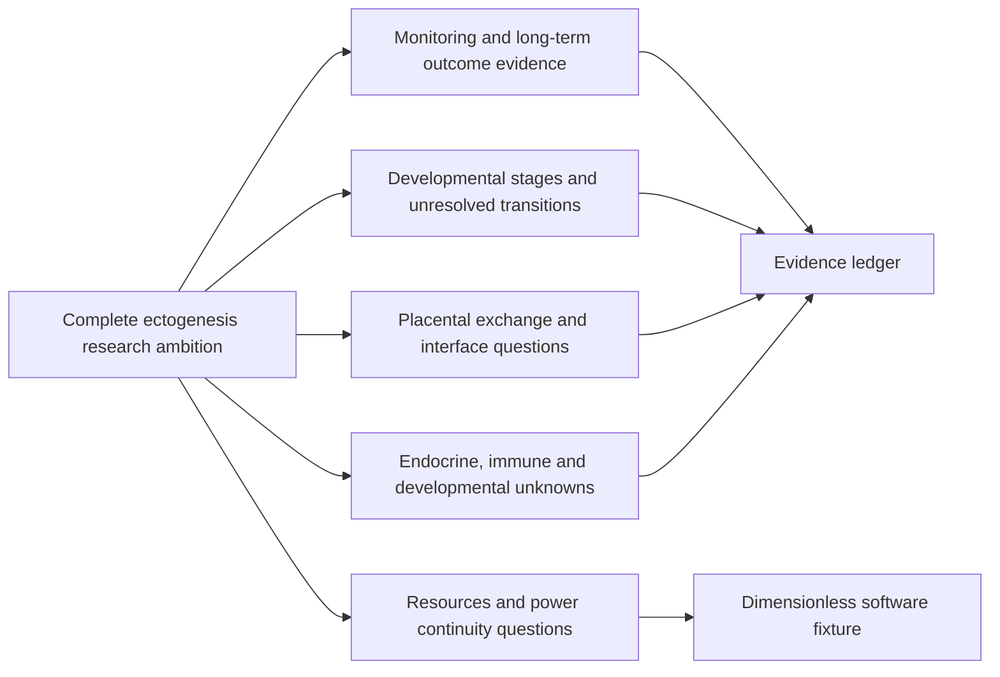

# Artificial womb models

This is a personal hobby and learning project, developed with substantial assistance from AI coding tools.

An open research software project investigating **complete human ectogenesis: development from IVF through birth outside a human uterus**. A wall-powered artificial womb that could eventually remove the need for gestational surrogacy is the long-term ambition. The first release makes the evidence gaps inspectable and the software experiments reproducible.

The repository contains a curated stage/evidence map and an abstract exchange, backup-power and monitoring fixture. Its outputs measure software behavior. Complete human gestation, replacement of surrogacy and fewer congenital defects remain unassessed or undemonstrated in the evidence ledger last updated on 2026-10-06. The project evidence map is not an independent scientific review.

The [master program plan](PROGRAM_PLAN.md) defines the owner goal: owned equipment for at least one successful surrogate-free gestation, assuming 100+ embryos available upstream; one or a few concurrent gestations counts as success and larger concurrency with a common birth date is an aspiration, not a requirement. It adds computer/laboratory feedback and physical engineering; AI/robot care and development goals are tracked in a separate private repository. The [current progress comparison](PROGRAM_STATUS.md) and [versioned register](config/program/roadmap.json) distinguish completion requirements from demonstrated software/source contributions and unestablished biological capabilities.

The [research program](RESEARCH_PROGRAM.md) supplies the detailed transition and benchmark contracts. The [implementation roadmap](ROADMAP.md) retains the numerical, uncertainty and portable-verification history. Use the master plan and register to select new work.

The [machine concept design](SYSTEM_DESIGN.md) proposes an individual continuous gestation unit, a dedicated support/observation station and a neonatal transition station. It specifies functional requirements, alternative interfaces, outcome assessment and research gates. Complete human embryo-to-birth support remains unestablished; the document is an AI-assisted research architecture, not a build specification or a guarantee of a healthy child.

Start with the [document map](DOCUMENT_MAP.md), which groups every root document, or jump to the [quick start](#quick-start), the [in silico modeling work](#in-silico-design-and-modeling) or the [command reference](#command-reference).

## Quick start

Python 3.10 or newer; the runtime has no third-party dependencies.

```bash
python -m venv .venv
. .venv/bin/activate        # Windows PowerShell: .venv\Scripts\Activate.ps1
python -m pip install -e .
wombmodels simulate --config examples/exchange_fixture.json --out artifacts/exchange-v1
wombmodels verify-bundle --bundle artifacts/exchange-v1 --strict
python -W error::ResourceWarning -m unittest discover -s tests
```

Every output directory must be new, so repeat a command with a different `--out`. All numerical outputs are dimensionless software fixtures. In a fresh clone, the tests that audit locally held source files are reported as skipped rather than passed; see [Development and verification](#development-and-verification).

## What you can run

The [program status workflow](config/program/README.md) checks pinned local evidence and transitive task dependencies, then publishes a fresh receipt-backed status bundle. It cannot establish scientific acceptance or advance a biological gate.

The [machine concept schematic](config/schematics/ectogenesis_platform_v1.json) renders the automation-first platform layout (containment, fluidics, monitoring/control and robotic servicing with human override) as a standalone SVG/HTML page via `python -m wombmodels.schematics --config config/schematics/ectogenesis_platform_v1.json --out <new-dir>`. It is a concept layout for planning and criticism, not a build specification.

### In silico design and modeling

Decision D12 (2026-10-17) made modeling the physical system in silico the program's working mode rather than a phase to finish; the [correction record](INSILICO_MODELING_CORRECTION_2026-10-17.md) explains why. The designs are in silico concepts and the fixtures are artificial dimensionless software constructs. None carries physiological calibration, biological prediction, a setpoint or machine-control output, and no synthetic result is registered as a biological assay.

| Task | Deliverable | Where |
| --- | --- | --- |
| T17 | Whole-system design of the early exchange interval: one shared function skeleton with living-interface, staged-support and synthetic-replacement variants | [design](WHOLE_SYSTEM_INSILICO_DESIGN_2026-10-17.md), [schematic v2](config/schematics/early_exchange_system_v2.json) |
| T18 | The same system carried through sustained exchange, fetal maturation and neonatal transition | [design](WHOLE_INTERVAL_INSILICO_DESIGN_2026-10-17.md), [schematic v3](config/schematics/whole_interval_system_v3.json) |
| T19 | Growth-paced capacity-scaling exchange fixture | `growth-scaling-model` |
| T20 | Spatial internal-delivery identifiability fixture | `spatial-delivery-model` |
| T21 | Integrated whole-path system twin across the interface variants | `whole-path-twin` |
| T22 | Growth-accommodation wall mechanics | `growth-mechanics-model` |
| T23 | Coupled mechanical twin (one-way wall coupling) | `mechanical-twin-model` |
| T24 | Minimum-measurement acquisition specification computed from the twin | `acquisition-spec-model` |
| T25 | Platform and resource decision worksheet from that specification; prices stay unknown | `platform-requirements-model` |
| T26 | Numerical stability, exact event accounting and convergence qualification of the fixture solvers | [qualification](NUMERICAL_INTEGRATION_QUALIFICATION_2026-10-22.md) |
| T27 | Damage-gated reciprocal wall-to-fluidic bulk-leak experiment | `reciprocal-twin-model` |

The schematics render with `python -m wombmodels.schematics --config <layout.json> --out <new-dir>`. `platform-requirements-model` consumes an `acquisition-spec-model` bundle through `--spec`. [The sequencing challenge](T05_SEQUENCING_CHALLENGE_2026-10-17.md) records why independent-reviewer recruitment was deferred behind this work, and [PROGRAM_STATUS.md](PROGRAM_STATUS.md) holds the task states.

Acquisition plans qualify each channel at the first post-handoff where every variant pair separates simultaneously. Each channel's resolution and unit counts use that observation; the full sampling plan extends through the latest selected handoff. Reports distinguish partial discrimination from no discrimination, retain failed seeded confirmations, and treat a multiplier floor as not applicable when reference noise is zero. These are fixture-specific observation plans; joint-channel and longitudinal alternatives remain unassessed.

The [numerical qualification](NUMERICAL_INTEGRATION_QUALIFICATION_2026-10-22.md) corrects substep clocks, integrates shortened terminal intervals, and splits twin integration at outages and reserve exhaustion. The wall subcycles independently using a stiffness/viscosity bound; coupled and uncoupled fluidic results remain exactly equal. Independent analytic solutions and refinement checks cover the repaired cases. Stability guards and passing examples do not establish accuracy for every allowed configuration.

### Command reference

The `wombmodels` command has one subcommand per row. Fixture-driven commands run from a fresh clone. The `audit-*` commands verify a published source file against a pinned SHA-256; this repository does not redistribute those files.

| Command | What it does | Input |
| --- | --- | --- |
| `evidence-report` | Validate and report a reviewed evidence ledger | `config/evidence.json` |
| `validate-observations` | Validate source-linked developmental observations and preserve exact-unit groups | a dataset card, e.g. `examples/observation_intake_fixture.json` or `config/observations/`; `--source-root` hashes local source files |
| `validate-phenotypes` | Audit individual phenotype coverage, exclusions and experiment/source hierarchy; no effect estimation | a dataset card, e.g. `examples/phenotype_intake_fixture.json` |
| `audit-hori-source` | Audit the pinned Hori 2024 Figure 5G workbook offline; no model fit | a pinned published workbook (not redistributed here) |
| `audit-fattahi-source` | Audit pinned Figure 2 functional readouts offline; no pairing or model fit | a pinned published workbook (not redistributed here) |
| `collection-accounting` | Construct dimensionless concentration/inventory/collection ambiguities; no biological fit | `examples/collection_accounting_fixture.json` |
| `audit-roelofsen-source` | Recover pinned embedded native Prism CSV tables offline; no saved analysis or model fit | a pinned published supplement (not redistributed here) |
| `audit-mathiesen-source` | Audit pinned human placental perfusion concentrations offline; preserve time, run mapping and source-validity windows without fitting | a pinned published article, workbook and three tables (not redistributed here) |
| `audit-guo-source` | Audit pinned niche mechanical/profile cells and candidate developmental percentages; no fit or pairing | a pinned published workbook (not redistributed here) |
| `audit-yolk-sac-source` | Audit pinned mouse yolk-sac readout cells and source timing; no unit inference or fit | a pinned published workbook (not redistributed here) |
| `audit-boundary-source` | Audit pinned native boundary/growth source CSV linkage offline; no biological identity inference or fit | a pinned published CSV archive (not redistributed here) |
| `audit-crest-linkage` | Audit pinned early-interface sample pools and annotation labels offline; no phenotype fit | a pinned published SDRF table and code archive (not redistributed here) |
| `transport-identifiability` | Construct dimensionless core-only and equilibrium observation ambiguities; no empirical fit | `examples/transport_identifiability_fixture.json` |
| `growth-scaling-model` | Run the dimensionless growth-paced capacity-scaling exchange fixture; no empirical fit | `examples/growth_scaling_fixture.json` |
| `growth-mechanics-model` | Run the dimensionless growth-accommodation wall fixture; no empirical fit | `examples/growth_mechanics_fixture.json` |
| `mechanical-twin-model` | Run the dimensionless coupled mechanical twin; no empirical fit | `examples/mechanical_twin_fixture.json` |
| `reciprocal-twin-model` | Test dimensionless damage-gated wall-to-fluidic bulk leakage; no empirical fit | `examples/reciprocal_twin_fixture.json` |
| `acquisition-spec-model` | Compute the dimensionless minimum-measurement acquisition specification from the twin; no empirical fit | `examples/acquisition_spec_fixture.json` |
| `platform-requirements-model` | Turn the published acquisition specification into the dimensionless capability worksheet; prices stay unknown | `examples/platform_requirements_fixture.json` and an `acquisition-spec-model` bundle (`--spec`) |
| `spatial-delivery-model` | Run the dimensionless spatial internal-delivery identifiability fixture; no empirical fit | `examples/spatial_delivery_fixture.json` |
| `whole-path-twin` | Run the dimensionless whole-path system twin across interface variants; no empirical fit | `examples/whole_path_twin_fixture.json` |
| `simulate` | Run a dimensionless, nonphysiologic exchange fixture | `examples/exchange_fixture.json` |
| `identifiability-report` | Analyze dimensionless input/conversion identifiability from a synthetic trajectory | `examples/exchange_fixture.json` and the `simulate` trajectory |
| `design-sweep` | Compare bounded seeded cadence/noise, monitor-fault and event-timing profiles | `examples/exchange_fixture.json` |
| `desk-status` | Read-only discovery of a local ResearchDesk ectogenesis blueprint | a ResearchDesk server on a numeric loopback address |
| `transport-model` | Run a dimensionless two-compartment transport theory fixture | `examples/transport_fixture.json` |
| `mechanics-model` | Run a dimensionless Kelvin–Voigt mechanics theory fixture | `examples/mechanics_fixture.json` |
| `verify-transport` | Measure dimensionless transport Euler error against a closed-form reference | `examples/transport_fixture.json` |
| `verify-mechanics` | Check dimensionless mechanics against a closed-form piecewise-load reference | `examples/mechanics_fixture.json` |
| `verify-transport-matrix` | Check transport Euler convergence across seven dimensionless rate regimes | `examples/transport_fixture.json` |
| `verify-bundle` | Verify a published bundle's receipt, files, parent ancestry and declared dependencies | any published bundle directory |

### Source audits and intake notes

What follows is the detailed account of each source audit and intake module, roughly in the order the work was done. Each paragraph keeps its own limits; none of these candidates establishes continuous human gestation.

The [niche-source qualification](NICHE_SOURCE_QUALIFICATION.md) adds
`audit-guo-source`: a pinned read-only audit of mouse niche mechanical/profile
cells and developmental percentages. It separates candidate observation intake
from unqualified mechanical quantities, specimen pairing, equivalence and causal
claims. Source row counts remain separate from verified biological n.

The [feasibility strategy](FEASIBILITY_STRATEGY.md) now prioritizes a remodelable
maternal niche, the same-unit transition to sustained exchange, and joint
support/development outcomes. New early mouse niche evidence and ovine growth
findings refine the hybrid-interface hypothesis and its failure conditions;
they establish no continuous human path or operating specification.

The [early exchange transition](EARLY_EXCHANGE_TRANSITION.md) refines the
biological boundary to include yolk-sac and other extraembryonic functions.
It separates supportive niche effects, connected exchange, developmental
function relay and durable outcomes. A pinned primary-source inventory retains
species distinctions, adverse later findings and unresolved timing; none of
these candidates establishes continuous human gestation.

The [functional support routes](FUNCTIONAL_SUPPORT_ROUTES.md) compare the
growing biological interface with a bounded placental-bypass hypothesis.
A 2026 mouse preprint motivates that comparison; an inspected peer-reviewed
metabolic reference separates delivery from developmental use. Published
source workbooks retain sample/time distinctions and a normalization
label/formula discrepancy; biological fitting and human continuity remain
unestablished.

The [terminal-boundary intake](MIDGESTATION_BOUNDARY.md) adds a runnable candidate
card with nine qualitative preprint findings and one missing follow-up
requirement. It preserves late adverse effects, different starting cohorts,
unknown unit continuity and unpinned original source bytes. Intake reports now
retain an explicit `preprint` class independently of local review status.

The [material handoff requirements](MATERIAL_HANDOFF_REQUIREMENTS.md) distinguish
uptake into support tissue from onward passage, secretion and recipient use.
A pinned mouse source supplies a 14-record candidate intake with compartment,
material, quantity basis and assessment context. It preserves mixed findings,
selection and missing follow-up; the added metadata establishes no mechanism
or continuous gestation.

The [support/development comparison](SUPPORT_DEVELOPMENT_DISCORDANCE.md) adds
`audit-yolk-sac-source`: a pinned read-only audit of 310 source cells that retains
a manuscript/table timing discrepancy and excludes unqualified concentrations
from observation intake. Selected mouse component assays coexist with an
embryo-arrest narrative; same-unit function/progression and causal explanation
remain unqualified.

The [moving-boundary requirement](DYNAMIC_BOUNDARY_REQUIREMENTS.md) adds a pinned
mouse implantation source with eleven comparative findings and a missing linked
follow-up. It separates early composite morphology from membrane presence and
model-inferred forces, and qualifies public imaging metadata as a segmentation
resource. Prior yolk-sac supplements now clarify aggregate cohort counts and
batch replication without establishing individual pairing or human feasibility.

`audit-boundary-source` now audits that study's native Figure 6 CSV archive:
it recovers 53 candidate length/cell-count key pairs and retains 17 length-only
records. Boundary trajectories lack an embryo ID, so a shared dataset code
cannot establish a boundary/outcome join. Original units, nested labels, zeros
and the caption/track-label discrepancy remain explicit; no biological fit is
performed.

The [boundary reanalysis contract](BOUNDARY_REANALYSIS_CONTRACT.md) separates
paired morphology, earlier coordination and conditional shape prediction.
Inspected appendix evidence retains successful-development selection, a later
model mismatch in one of three validation embryos, the held-out measured growth
input and an unqualified absolute force scale. Public segmentation code metadata
and selected files do not recover the missing embryo/outcome map.

The [maternal-interface requirements](MATERNAL_INTERFACE_REQUIREMENTS.md) add
a living mouse uterine-tissue comparator and a 12-record candidate intake.
They separate favorable early attachment from retained embryos, assessed
embryonic compartments and maternal-state readouts. Native source tables explain
assay withdrawals and preserve a conditional count discrepancy; no same-unit
exchange path, biological fit or human gestation claim is established.

The [interface source qualification](SOURCE_QUALIFICATION.md) audits the Hori
2024 Figure 5G workbook and two Bhide 2026 kinetic supplements. The new
`audit-hori-source` command extracts 48 source-located Papp endpoints into a
candidate intake and descriptive summaries. These are published coefficients
with their exact reported units, separate from model fixtures. The inspected
files cannot support an independent-unit transport benchmark; missing
trajectories, unit linkage and review requirements are recorded explicitly.

[Interface feasibility](INTERFACE_FEASIBILITY.md) now defines separate
exchange-identifiability and tissue-interaction questions. The runnable
`transport-identifiability` diagnostic exposes an exact core-only ambiguity
and an equilibrium rate-scale ambiguity in the dimensionless equations.
It specifies why paired transient observations matter without assigning
biological parameters. An early implantation source and its public data/code
resources remain candidates awaiting phenotype linkage and human review.

The [early-interface reanalysis contract](CREST_REANALYSIS_CONTRACT.md)
recovers source-declared pools and overlapping membership, with an offline
`audit-crest-linkage` command. Observation intake now retains pool members
and rejects overlapping independence assertions. Pool labels cannot establish
individual developmental continuity; actual functional values and specimen
links remain a separate data requirement.

The [phenotype intake](PHENOTYPE_INTAKE.md) validates starting specimen
rosters, endpoint coverage, exclusions and experiment/source hierarchy.
`validate-phenotypes` preserves exact source units and produces descriptive
groups without estimating an effect. Its example is entirely artificial
and dimensionless; the original functional measurements remain outstanding.

The [selective-interface exploration](SELECTIVE_INTERFACE_FEASIBILITY.md)
checks two additional primary human tissue-model studies and distinguishes
nutrient delivery, barrier leakage, injury and endocrine readouts.
`audit-fattahi-source` preserves published functional values and source
locators without inferring specimen pairing or fitting a physiological model.

The [collection-accounting exploration](COLLECTION_ACCOUNTING.md) recovers
embedded native Prism CSV tables from a pinned placental-perfusion supplement
with `audit-roelofsen-source`. Processed percentages, source-declared replicate
counts and unresolved donor linkage stay explicit. `collection-accounting`
constructs dimensionless counterexamples separating concentration, inventory,
collection and unresolved sinks; it assigns no biological parameters.

The [native-data qualification card](ROELOFSEN_DATA_REQUIREMENTS.md) now resolves
the referenced trajectory time unit and adds a cell-level candidate intake.
Selection of successful perfusions, starting/excluded attempts, specimen links
and tissue subcolumns remain explicit review requirements. Observation intake
can verify local source bytes while preserving those unresolved identities.

The [Mathiesen perfusion qualification](MATHIESEN_PERFUSION_QUALIFICATION_2026-10-10.md)
adds a pinned source-cell intake of maternal/fetal placental reservoir
concentrations, source-run windows and missingness counts for five analytes.
It retains the separate, unreconciled selection funnel and 22-run workbook.
The descriptive tryptophan ratio is not flux; missing sample-volume/removal,
inventory/recovery and calibration records keep dimensional fitting ineligible.
Run `audit-mathiesen-source` (including `--s3-table` for a non-joining candidate
key screen) followed by `validate-observations` to reproduce the candidate
bundles.

### Example commands and outputs

Windows PowerShell forms of the main fixture commands, each writing a new directory under `artifacts/`.

```powershell
python -m venv .venv
.venv\Scripts\python -m pip install -e .
.venv\Scripts\wombmodels evidence-report --ledger config/evidence.json --out artifacts/evidence-v1
.venv\Scripts\wombmodels simulate --config examples/exchange_fixture.json --out artifacts/exchange-v1
.venv\Scripts\wombmodels identifiability-report --config examples/exchange_fixture.json --trajectory artifacts/exchange-v1/trajectory.csv --out artifacts/identifiability-v1
.venv\Scripts\wombmodels design-sweep --config examples/exchange_fixture.json --out artifacts/design-sweep-v1 --replicates 8
.venv\Scripts\wombmodels transport-model --config examples/transport_fixture.json --out artifacts/transport-v1
.venv\Scripts\wombmodels transport-identifiability --config examples/transport_identifiability_fixture.json --out artifacts/transport-ambiguity-v1
.venv\Scripts\wombmodels mechanics-model --config examples/mechanics_fixture.json --out artifacts/mechanics-v1
.venv\Scripts\wombmodels validate-observations --dataset examples/observation_intake_fixture.json --out artifacts/observation-intake-v1
.venv\Scripts\wombmodels verify-transport --config examples/transport_fixture.json --out artifacts/transport-verification-v1
.venv\Scripts\wombmodels verify-transport-matrix --config examples/transport_fixture.json --out artifacts/transport-matrix-v1
.venv\Scripts\wombmodels verify-mechanics --config examples/mechanics_fixture.json --out artifacts/mechanics-verification-v1
.venv\Scripts\wombmodels verify-bundle --bundle artifacts/identifiability-v1 --strict
.venv\Scripts\wombmodels desk-status --url http://127.0.0.1:8092
```

Each output destination must be new. Evidence reports include claims, a species-separated stage map, a transition map with source links where reported, requirements, the original input and a receipt. The transition CSV retains source locators, claim/source IDs and unit IDs when available; unsupported human edges remain `not_reported`, and no path-readiness score is computed. Simulations include trajectories, balance residuals, synthetic sensor fault metrics, the original fixture configuration and a receipt. The identifiability report retains an explicitly labeled integral-balance residual diagnostic and adds a noise-aware, nonnegative state fit plus a forward forecast trained through 70% of dimensionless run duration. It verifies the simulation receipt and event schedule, then scores later readings without using them as predictors. Its approximate prediction interval and all fitted values remain synthetic software diagnostics, not independent validation. Artifact formats are CSV, JSON and Markdown.

`design-sweep` compares three requested output-cadence factors with three sensor-noise multipliers using bounded seeded replicates (1–20 per design, within a four-million scheduled-sample budget). When monitor faults are configured, it also contrasts those intervals with a profile that removes injected monitor faults but retains wall outages and power-linked missing readings. Configurations with outages or monitor faults include a reflected event-timing profile that preserves interval lengths while moving events across the fixture timeline. `sweep_plan.json` records actual cadence/noise settings and the interval schedule for each timing profile. Each run reports a forward state-model forecast trained through 70% of dimensionless duration, a last-training-reading baseline, prediction-interval coverage and synthetic rate-recovery errors. The older same-run and leave-one-seed-out balance residuals remain as clearly labeled consistency checks: their interval predictors contain the observations being scored. All forecasts and replicates share one synthetic fixture and schedule; they are software diagnostics, not independent experimental validation or biological sampling recommendations.

The fixture has invented **dimensionless** stocks, rates, times and thresholds. It represents substrate conversion into waste, powered input and clearance, wall-power interruptions, finite backup reserve, and synthetic sensor bias/dropout. There is no conversion from its time coordinate into hours, gestational weeks or nine months. It computes no fetal physiology, development, probability of birth, machine-control action or biological safety rating.

Two additional theoretical fixtures make alternative equations and future measurable outputs explicit: a two-compartment transport model compared with a well-mixed reference, and a Kelvin–Voigt viscoelastic response compared with an instantaneous elastic reference. Each artifact names one developmental research track while keeping all model values dimensionless. [THEORETICAL_MODELS.md](THEORETICAL_MODELS.md) documents their equations, assumptions, identifiable measurements, alternatives and the shared [developmental observation contract](schemas/developmental-observation.schema.json). These fixtures are not biologically calibrated and do not set organismal or device parameters.

`validate-observations --dataset PATH --out NEW_DIRECTORY` checks a bounded, source-linked dataset card against [observation-dataset.schema.json](schemas/observation-dataset.schema.json). It retains species, actual interval, exact reported units, unit hierarchy, comparators, uncertainty, missingness, declared source-hash metadata and explicit transition-continuity states. Its report partitions records into exact matching groups without converting units or pooling values. Optional `cohort_coverage` records in [cohort-coverage.schema.json](schemas/cohort-coverage.schema.json) retain source-level counted entities, population frames, endpoint denominators, raw disposition labels/counts, each assertion's membership within or outside its denominator, printed percentages and source-located assay-selection statements separately from individual observation records. The report emits `cohort_coverage.csv`, `cohort_dispositions.csv` and `cohort_coverage_checks.csv`; count closure is calculated only when the source explicitly establishes a common cohort/window, complete dispositions, and mutually exclusive and exhaustive categories. Otherwise the check remains unassessed. Matching labels never create specimen identities or developmental continuity. The Hiraoka candidate preserves the reported 24h percentage alongside its differing count ratio and records later-assay withdrawals outside the later denominator without deriving a missing withdrawal count. To check source bytes available locally, add `--source-root DATA_DIRECTORY` and set an artifact's optional `local_path` to a relative file beneath that directory. The command streams files read-only, rejects symlinks and paths that escape the root, and caps total hashing at 2 GB. Source URIs are never fetched; source files are never copied into the bundle. Its receipt records the submitted dataset JSON and generated outputs, while the file-level report records hashes observed at verification time. A locally recorded source review is not authenticated, identifier counts are not verified biological units, and matching bytes do not establish rights, transcription accuracy, or data eligibility. The command performs no assay and runs on the Python standard library only.

Observation cards may optionally declare `assay.functional_evidence_class` as `direct_function_measurement`, `biological_response_proxy`, `developmental_outcome` or `other`. This records how an endpoint relates to a functional claim: a biomarker concentration can be a response proxy, while a directly observed transport quantity can be a process measurement. A developmental outcome can include growth, survival, an adverse effect, transition, or follow-up. Neither class proves sufficiency, mechanism or health. Missing classes remain unclassified; endpoint names are never used to infer them. The intake report counts declared classes and the observation/group CSV exports preserve them.

Observation records may also include source-located `measurement_conditions` such as operating mode and flow. These are validated and exported with each observation, and exact comparison groups include them so results from different settings remain separate. Conditions preserve test context; they do not imply repeat measurements, independent samples or pairs.

Observation artifacts can optionally declare `developmental_scope`: species, a list of stage tracks, exact `time_unit`, numeric or null `start`/`end`, and a `source_locator`. A null source bound preserves an unknown endpoint without discarding the known one. Records bind to the artifact named by `stage_source_artifact_id`; species, stage and exact time units must match. Every numeric record bound must satisfy all known source bounds, even when the other record bound is missing. Textual record intervals remain unassessed. Only fully numeric source and record intervals can be contained; partial checks remain included in `n_not_assessed` and are separately counted as `n_partially_checked`. Missing bounds are never inferred from prose. The receipt-bound `source_scopes.csv` and `source_interval_checks.csv` retain locators and each record's check status. This checks curated metadata, not the source transcription or biological continuity. Existing dataset cards can omit the scope, with an explicit unassessed status. The runnable [intake example](examples/observation_intake_fixture.json) uses invented dimensionless metadata and placeholder URLs; it supplies no biological evidence.

The curated evidence ledger also supports optional structured `interval_components` on sources and claims. When a cited source provides them, each claim must use the same axis and exact unit and remain within the source's numeric bounds; the validator does not convert units or infer ranges from prose. These bounds are curated metadata, not automated source transcription or scientific-review verification.

`verify-transport` evaluates the transport fixture's forward-Euler trajectory at five requested step sizes against an independent closed-form solution of the same constant-coefficient two-state equations. It publishes a receipt-bound convergence curve and the finest-step pointwise errors. The command is a numerical accuracy check for one supplied fixture configuration, not external validation or evidence about an organism.

`verify-transport-matrix` repeats that accuracy check across seven deterministic dimensionless regimes: the supplied configuration, zero dynamics, exchange-only, transfer-only, unequal coupled rates, high mixing and near-degenerate weak coupling. It publishes each exact scenario configuration, five-level error curves and a finest-step pointwise file per regime. Derived profiles reduce their step to a stated explicit-stability bound; an unstable supplied baseline is rejected. The fixed profiles are software stress cases, not biological parameters or experimental conditions.

`verify-mechanics` checks every mechanics output time against a separate piecewise-load convolution solution, with explicit pointwise and load-boundary error files. It covers exponential relaxation for positive elasticity and linear creep at the zero-elasticity limit. Since the production mechanics solver already uses an exact transition on every constant-load interval, this report is a closed-form consistency check rather than a step-halving convergence study or external validation.

## Verify a bundle after moving it

Every bundle now carries `reproduction_plan.json` beside its receipt: the
package version, Python version, declared dependencies, the command template, the
inputs, the complete expected file set and the interpretation limits. It contains
no absolute paths, so a copied bundle stays self-describing.

`wombmodels verify-bundle --bundle DIRECTORY` checks that bundle on its own.
It validates the receipt's structure without a schema library, rejects symlinked
and oversize outputs before reading them, recomputes every SHA-256 and byte
count, and resolves the recorded parent receipt. `identifiability-report` bundles
now copy the exact source `simulate` receipt in as `source_receipt.json`, so
ancestry still resolves after the original simulation directory is deleted.

The report keeps the questions apart: `bytes_verified` (bundle integrity),
`ancestry_resolved` (the declared parent receipt travels with the bundle and
matches), `scientific_review`, always `not_established_by_this_tool`, and
`reproduction`, always `not_attempted`. `--strict` also fails on files the
receipt does not declare and on bundle kinds this package does not publish.
The GitHub Actions workflow runs `verify-bundle --strict` on its simulation and
identifiability bundles, then on a renamed copy of the identifiability bundle
after the original directories are deleted.

## Developmental scope

| Research stage | First-release treatment |
| --- | --- |
| Preimplantation development | Explicit gap in this bounded source ledger |
| Implantation and placental interface formation | Unresolved stage and interface requirement |
| Postimplantation embryonic development | Mouse interval retained in mouse developmental notation |
| Partial support of an already-developed fetus | Ovine reports and intended human clinical scope kept separate |
| Transition into neonatal life | Separate from duration on support |
| Developmental and longer-term outcomes | Separate from physiological stability and survival |
| Continuous human IVF-to-birth gestation | Undemonstrated ambition in this ledger |

Different studies and species cannot be concatenated to claim a continuous gestation pathway. [EVIDENCE.md](EVIDENCE.md) describes source classes and the important adverse-growth finding; [METHODS.md](METHODS.md) gives the equations, boundaries and reproducibility contract.



This diagram organizes research questions; its arrows do not describe a demonstrated biological system or an assembly plan.

## ResearchDesk bridge

RegenWorkbench's `ectogenesis` blueprint provides normal source searches, evidence campaigns and dossier exports. This repository remains independently installable. `desk-status` makes one read-only request to the usual local `/api/state` endpoint and prints only the ectogenesis title, starter IDs and evidence-axis IDs. It accepts a numeric loopback HTTP(S) origin, disables proxies, refuses redirects, caps response size, and submits no jobs. Other notes and campaigns are neither printed nor written to disk.

A local ResearchDesk server can be inspected with the command above. Without that server, the offline artifact commands still work. The bridge is research organization and source discovery; it has no live control API. Synthetic exchange outputs are not registered as biological assays or `experiment.json` records.

When the sibling repos share the documented workspace layout, RegenWorkbench's `compose.research.yaml` mounts this repo's `artifacts/` directory read-only. Its ectogenesis **Model bench** checks receipt/source bindings, output byte counts and SHA-256 values, and displays evidence, simulation, identifiability, cadence/noise/fault/event-timing sweep, dimensionless transport, and dimensionless mechanics reports; simulation cards can plot the sampled trace and modeled power states. Runtime fingerprints, prediction baselines, and limitations recorded in each report are visible beside their summaries. A matching receipt establishes file integrity only; it does not review the claims or validate the model. Generate a new bundle under `artifacts/` and refresh the view to discover it.

## Development and verification

From the parent shared workspace:

```powershell
docker compose run --rm dev bash -lc 'cd /workspace/artificial-womb-models && PYTHONPATH=src python3 -W error::ResourceWarning -m unittest discover -s tests -v'
```

On a host with Python, after installing the package:

```powershell
python -W error::ResourceWarning -m unittest discover -s tests -v
```

`artifacts/` is gitignored. It holds the published source files that the source audits pin by SHA-256 (not redistributed here) and the bundles built from them, so a fresh clone lacks it. Tests that audit those files carry `requires_local_evidence` ([tests/local_evidence.py](tests/local_evidence.py)) and are reported as **skipped**, never as passed. With the full local `artifacts/` tree nothing is skipped, and a missing or changed file inside a directory that is present still fails. Everything else runs in a clean clone, which is what GitHub Actions executes on Python 3.10, 3.12 and 3.13.

Before pushing, run `python scripts/clean_checkout_tests.py`. It exports the working tree as a clean clone would receive it (tracked and new files, `.gitattributes` applied, no `artifacts/`) into a temporary directory and runs the suite there, so a test that only passes beside the local evidence is caught. `.gitattributes` keeps the curated data under `config/observations`, `config/perfusion_observations` and `config/source_inventories` byte-exact, because tests, source inventories and the program register pin those files by SHA-256 and byte size.

The sensitivity and identifiability diagnostic asks whether scheduled measurements from this dimensionless fixture separate powered input from conversion. High parameter correlation, a poorly conditioned design, or weak later-interval fit expose ambiguity. These are diagnostics of software equations, not biological measurement design. [METHODS.md](METHODS.md) describes estimation and limits; [ROADMAP.md](ROADMAP.md) describes the research path.

## Credits, sources and licence

- **Research.** This repository maps and audits other people's work; it does not reproduce it. The curated ledger ([EVIDENCE.md](EVIDENCE.md), `config/evidence.json`) draws on [Partridge et al. 2017](https://doi.org/10.1038/ncomms15112) (Nature Communications), [Aguilera-Castrejon et al. 2021](https://doi.org/10.1038/s41586-021-03416-3) (Nature) and [Usuda et al. 2023](https://doi.org/10.3389/fphys.2023.1219185) (Frontiers in Physiology), plus an FDA 2023 background presentation and a 2026 Hospital Clinic BCNatal announcement, which the ledger keeps separate from peer-reviewed results. The dated source screens in the [document map](DOCUMENT_MAP.md) cover many further studies and public datasets. Each audit or intake card records the source it inspected, its retrieval date and a SHA-256 for the file; the authors and data depositors retain all rights.
- **Software.** Python standard library only at runtime. GitHub Actions runs the tests, and GitHub renders the Mermaid diagram.
- **AI assistance.** Substantial assistance from AI coding tools, Anthropic's Claude among them (some commit trailers name it), went into the code, tests and documents. Analyses here were run by AI agents working from the owner's instructions; unless a document records a review by the owner or an independent reviewer, treat its results as unreviewed.
- **Licence.** The code is MIT licensed. Source papers retain their original rights; the ledger contains short attributed summaries and links, not redistributed article text or figures.
