# Concept design: continuous ectogenesis platform

Design revision: 2026-10-09. Status: proposed functional architecture for research.
Authorship: AI-assisted project design; no human scientific or clinical review is
recorded. This is a requirements and evidence-gap design, not a build specification
or a demonstrated embryo-to-birth machine.

The intended system would accept an embryo at a declared developmental stage,
support continuous embryonic and fetal development outside a uterus, and enable
transition to neonatal life. Its objective is a healthy newborn with independently
assessed development and subsequent follow-up. Healthy adulthood is a later outcome,
not something established at the machine's exit.

The sources checked for this revision do not establish complete human ectogenesis.
Neither an environment controller nor any proposed architecture can promise that
every embryo will become a healthy child. Congenital conditions have genetic,
environmental and incompletely understood causes, and some are detected later;
environmental control does not establish their prevention.
[CDC: About birth defects](https://www.cdc.gov/birth-defects/about/)

The recommended research architecture has **three functional machines**:

- **A — Individual gestation unit:** one continuous, growth-accommodating biological
  chamber per embryo, with a changing developmental interface.
- **B — Support and observation station:** dedicated support services, independent
  observation, resource continuity and operator supervision for that unit.
- **C — Neonatal transition station:** a separately assessed transition and care
  environment, followed by longitudinal outcome assessment.

These are functional allocations. Their shape, materials, dimensions, biological
composition, operating parameters and physical connections are unresolved. A
functional box is not evidence that its biology can be implemented.

```mermaid
flowchart LR
    I[Embryo at declared starting stage]
    subgraph A[Machine A: individual continuous gestation unit - proposed]
        A0[Early developmental support]
        A1[Implantation and interface establishment]
        A2[Embryonic development and interface growth]
        A3[Fetal development and maturation]
        A0 -. unestablished transition .-> A1
        A1 -. unestablished transition .-> A2
        A2 -. unestablished transition .-> A3
    end
    B[Machine B: dedicated support and independent observation - proposed]
    C[Machine C: neonatal transition station - proposed]
    N[Newborn assessment]
    F[Longitudinal outcomes and adverse findings]
    I -. proposed entry .-> A0
    B -. required functions .-> A
    A3 -. unestablished transition .-> C
    C -. assessed transition .-> N
    N --> F
```

The arrows identify research dependencies, not an assembly plan or a biological
procedure. No depicted continuous human path is currently demonstrated by the
project's ledger.

## Why one continuous chamber

The central design hypothesis is to preserve the developing embryo/fetus and its
extraembryonic interface in one habitat while support functions change around it.
This could reduce disruptions from moving between machines with incompatible
interfaces. It might also prove infeasible: a chamber suitable for early development
could constrain later growth, observation or interface maintenance. Both possibilities
need measured evidence.

| Architecture option | Potential advantage | Principal unresolved burden | Design decision |
| --- | --- | --- | --- |
| Separate machines for each biological stage | Each stage can be investigated separately | Every physical transfer adds an unestablished continuity boundary | Keep as a research comparator |
| One fixed chamber with identical support throughout | Fewer transfers | Assumes early and late requirements can be met by one unchanged environment | Do not assume this suffices |
| Continuous habitat with stage-dependent support functions | Preserves identity and could preserve the developing interface | Requires compatible early biology, growth accommodation and support changes | Preferred hypothesis to investigate |

The architecture seeks to support endogenous development. It does not construct a
person by assembling organs, and machine intelligence is not assumed to supply the
missing developmental biology.

## Machine A: individual gestation unit

The unit owns the continuous biological boundary and the unit identifier. Its
requirements change with observed developmental state; elapsed software runtime is
not a substitute for developmental maturity.

| Functional region | Required capability | Evidence that would establish progress | Current design status |
| --- | --- | --- | --- |
| Early developmental habitat | Preserve the source-defined embryonic and extraembryonic starting states and their progression | Same-unit lineage, morphology and attrition records with declared starting and ending stages | Limited early human research exists; full path unresolved |
| Implantation/interface region | Support the transition to an organized, growing interface with independently measured exchange and developmental function | Same-unit observations connecting early organization, interface formation and later development | Unestablished human full-path interface |
| Expanding developmental habitat | Accommodate growth and changing biological boundaries without assuming unchanged demands | Longitudinal structure and function plus adverse findings under relevant comparators | Proposed requirement |
| Fetal habitat | Preserve fetal development while support needs change | Independent organ maturation, growth, function and later outcomes alongside support records | Animal partial-support precedent; embryo-origin human continuity unestablished |

The interface region is the main biological research problem. A fetal support device
that begins after prior development in a uterus does not explain how an embryo
establishes its earlier support interface.

Two interface hypotheses remain separate:

1. **Hybrid biological interface:** preserve developing extraembryonic tissues and
   investigate a surrogate for their maternal-facing environment. The engineering
   burden includes sustaining a changing living interface and detecting its failure.
2. **More fully synthetic functional replacement:** separately reproduce the required
   exchange, signaling, barrier and mechanical functions. This assumes those functions
   can be identified and reproduced without omitting developmental interactions.

The hybrid approach is the preferred hypothesis for initial interface research;
neither is established as a complete human gestation solution. Comparative measured
function and developmental outcomes must decide between them. Matching a few
molecular markers or exchanging a tracer cannot establish the whole interface.

The [feasibility strategy](FEASIBILITY_STRATEGY.md) sharpens this hypothesis:
the maternal niche must accommodate mechanical response and remodeling while
extraembryonic tissues establish a sustained, growing interface. The early-to-
sustained-exchange boundary remains a separate unestablished capability.
Require joint support and organ/lineage development: stable circulation can
coexist with abnormal growth in partial-support evidence. Fixed-niche,
fixed-barrier and stage-separated designs remain research comparators.

The [early exchange transition](EARLY_EXCHANGE_TRANSITION.md) makes yolk-sac
and other extraembryonic functions explicit within this boundary. Preserve
their changing relationships to the embryo and distinguish early provision,
connected exchange, developmental function relay and durable development.
Vascular niche morphology or early implantation cannot establish all four.
The inspected early-development experiment supports mouse embryos with
human-origin cells; it does not establish a human developmental transition.

The [functional support routes](FUNCTIONAL_SUPPORT_ROUTES.md) retain a bounded
placental-bypass comparator alongside the growing living interface. Qualify
required functions for each interval instead of assuming a formed placenta
must supply every one. Machine B must distinguish material delivery, tissue
metabolic use and developmental progression. Adequate tracer delivery can
coexist with impaired metabolism and development in the inspected mouse
reference; no external-supply correction or human operating setting follows.

The [terminal-boundary intake](MIDGESTATION_BOUNDARY.md) further requires
internal/compartment delivery evidence as growth proceeds, alongside adverse
outcome timing. Selected mouse preprint passages report late slowing and
terminal injury; their attributed delivery mechanism remains unqualified.
Molecular endpoint resemblance does not close that boundary, and destructive
tissue assessment remains a separate sampling branch from later survival.

The [material handoff requirements](MATERIAL_HANDOFF_REQUIREMENTS.md) add uptake,
processing/passage, release and recipient use as separately qualified functions.
Mouse yolk-sac comparisons show why tissue abundance cannot alone establish
effective onward delivery. Machine B retains the observed compartment,
material, quantity basis and assessment branch; missing linkage prevents these
readouts from becoming a measured chain or a diagnosis of terminal failure.

The [support/development comparison](SUPPORT_DEVELOPMENT_DISCORDANCE.md) requires
usable exchange and appropriate embryonic tissue coordination together. Selected
mouse yolk-sac function persists alongside an embryo-arrest narrative; a working
support component alone cannot certify organism-level progression. The source
does not identify a particular physical constraint, input or control correction.

The [moving-boundary requirement](DYNAMIC_BOUNDARY_REQUIREMENTS.md) adds a
bounded comparative mouse source: early growth is coordinated with trophoblast
and membrane displacement in a maternal-facing context. Machine A must qualify
that changing tissue relationship alongside exchange; a fixed geometry or
stiffness alone cannot establish it. Machine B must retain source-unit trajectories,
inferred-versus-measured quantities and individual outcomes. The source reaches
an early egg-cylinder endpoint, with failures retained; it supplies no human
mechanical setting or evidence of later continuous support.

The native source audit further requires Machine B's records to distinguish
specimen identity from dataset, image-stack, measurement-line and cell-track
labels. Endpoint-key matches can qualify a partial comparison after review,
while an absent embryo link keeps trajectory-to-outcome continuity unresolved.

## Machine B: support and observation station

The [selective-interface exploration](SELECTIVE_INTERFACE_FEASIBILITY.md)
refines the interface requirement: separately qualify directional nutrient
delivery, unintended passage, tissue injury and endocrine readouts. A
single permeability coefficient or uptake signal cannot establish that
joint function. New human tissue-model candidates motivate this distinction;
they do not close continuous-development gates or supply machine settings.

The station is an engineering layer around the biological boundary. Functional
requirements are specified here without prescribing biological setpoints or control
actions.

| Subsystem | Responsibility | Evidence/verification obligation |
| --- | --- | --- |
| Exchange support | Account separately for delivery, removal and the interface's own behavior | Unit-safe measured exchange, independent observations and accounting residuals; fit only quantities the measurements identify |
| Developmental signaling support | Identify which maternal/interface functions must be maintained as stages change | Source-linked functional perturbation evidence and alternatives; a signal inventory alone is insufficient |
| Habitat support | Maintain the conditions and mechanical context required by the qualified biological model | Model-specific exposure records and independently assessed developmental outcomes |
| Boundary protection | Characterize contamination, exposure, compatibility and interface failure | Recorded adverse findings, missingness and boundary integrity; no assumed universal biocompatibility |
| Independent observation | Distinguish hardware state, support performance and biological development | Calibrated observations with uncertainty, sensor failure states and explicit unobservable quantities |
| Resource continuity | Address power loss, resource interruption, maintenance and common-cause failures | Offline fault cases and independent engineering qualification; software reserve tests are not biological survival evidence |
| Supervision and records | Preserve identity, operator decisions, uncertainty and complete source revisions | Append-only study records with review history and separation of observed, inferred and unassessed states |

Observation has three separate levels: **equipment functioning**, **support delivery**,
and **developmental outcome**. Success at one level does not imply success at the
next. The station must expose unavailable readings and disagreement rather than
turning missing evidence into a reassuring health score. A future observer can use
only readings already available at the reported time; synthetic generator truth
cannot serve as deployment ground truth.

No universal automatic shutdown is defined. Loss of support may itself be hazardous,
and the appropriate response to failure depends on the biological state and qualified
care options. Escalation and continuity requirements need specialist review; this
document supplies no intervention protocol.

## Machine C: neonatal transition station

Transition to neonatal life is a separate system requirement. Its conceptual role
is to support a professionally supervised change from the fetal support state to
neonatal function and subsequent care. It must be evaluated independently of how
long the preceding machine operated.

Required outcome categories include respiratory and circulatory adaptation, organ
function, feeding-related development, neurological assessment, adverse events,
survival and follow-up. A maturity assessment must retain measurement uncertainty;
it cannot be inferred from a countdown, fetal size alone, or a successful software
simulation. The design does not specify a transfer, delivery or clinical procedure.

## Multiple embryos

Scale the concept by replicating the individual unit and its dedicated support
boundary. Multiple occupants of one gestation chamber are outside this design.

Shared facility services would need qualified isolation, local continuity and
failure accounting. Biological-contact paths and records remain unit-specific. A
failure affecting several units must be counted as a common-cause event, not as
independent evidence about each unit's reliability. Network availability and a
fleet dashboard cannot become the sole source of supervision or continuity.

## Define the intended outcome without a health guarantee

The design's target is continuous support through birth with outcomes assessed
against prespecified, appropriate comparators. Each starting unit remains in the
denominator; losses, exclusions, adverse outcomes and missing follow-up remain
visible. Results restricted to survivors cannot establish an embryo-to-healthy-child
success rate.

| User objective | Required assessment | Insufficient substitute |
| --- | --- | --- |
| Intact development | Prespecified anatomical and developmental assessment with source-defined ascertainment windows | Appearance in one image |
| Functional newborn | Independently assessed organ function and neonatal adaptation | Stable equipment readings or circulation alone |
| Healthy child | Longitudinal developmental and health outcomes, adverse findings and missing follow-up | Survival to chamber exit |
| Benefit over alternatives | Appropriate comparative outcomes with reviewed methods and uncertainty | Environmental controllability or a theoretical model |

No percentage, safety score or lifetime benefit is assigned by this concept. A
specific congenital-condition benefit would require its own evidence and comparator.
Disability is not a measure of a person's worth; outcome descriptions should name
the assessed functions and conditions rather than label people as defective.

## Evidence boundary checked for this revision

These summaries support scope distinctions. They do not qualify data for a model or
change the reviewed evidence ledger.

| Source | What was reported or discussed | Boundary for this architecture |
| --- | --- | --- |
| [Shahbazi et al., 2016](https://www.nature.com/articles/ncb3347) — primary human in-vitro research | Early implantation-stage self-organization without maternal tissues | Early morphogenesis does not establish a placenta sustaining complete gestation; candidate source awaiting project review |
| [Aguilera-Castrejon et al., 2021](https://pubmed.ncbi.nlm.nih.gov/33731940/) — primary mouse research | Postimplantation development from approximately E5.5 to E11, with a reported interval up to six days | Starts after implantation; no embryo-to-birth human demonstration |
| [Partridge et al., 2017](https://pmc.ncbi.nlm.nih.gov/articles/5414058/) — primary ovine research | Partial support of already-developed fetal lambs for up to four weeks | Supports investigation of later-stage functions; does not fill early developmental transitions |
| [Usuda et al., 2023](https://doi.org/10.3389/fphys.2023.1219185) — primary ovine research | Support up to 336 hours with circulation maintained but abnormal growth findings | Developmental success must be assessed separately from support stability |
| [FDA background, 2023](https://www.fda.gov/media/172252/download) — regulator discussion | Intended artificial-womb scope as a bridge for extreme prematurity | Discussion of development programs does not establish complete gestation or measured human efficacy |
| [BCNatal, July 3, 2026](https://www.clinicbarcelona.org/en/news/the-bcnatal-fetalife-project-for-the-most-extremely-premature-babies-achieves-a-survival-of-21-days-in-a-liquid-incubator) — institutional announcement | Announced ovine support for 21 days and a proposed future human study | Announcement and planned work remain distinct from primary measured human results |

Separate human early-stage, mouse embryonic and ovine fetal reports cannot be joined
into a demonstrated gestation pathway. This is a bounded source check, not an
exhaustive trial-registry audit or independent systematic review.

## Design gates and next deliverables

| Gate | Required deliverable | Advancement condition |
| --- | --- | --- |
| G0: input and scope | A declared starting stage, unit identity and exact proposed outcome | Scope reviewed; embryo stage and embryo-model class remain distinct |
| G1: early/interface continuity | Source-linked same-unit transition records and independently measured interface function | Relevant transition demonstrated in the stated model; morphology alone does not close the gate |
| G2: sustained development | Longitudinal embryonic/fetal development, growing interface performance and adverse outcomes | Development and function assessed against appropriate comparators, with losses retained |
| G3: engineering continuity | Qualified subsystem behavior and fault cases under the relevant model contract | No unsupported inference from dimensionless numerical fixtures to organismal survival |
| G4: neonatal transition | Same-unit support-to-neonatal records and outcome assessment | Transition and function assessed separately from support duration |
| G5: longer outcomes | Cohort-wide follow-up, adverse findings and missingness | Claims limited to actual ascertainment windows and reviewed endpoints |

Every gate for a continuous human embryo-to-birth system remains open in this
project. The next useful work is **G1 interface qualification**, alongside the
existing evidence/observation program: review candidate primary sources; obtain
eligible measured interface data; freeze one exchange/function question; compare
simpler alternatives; and report missing observables if the question cannot be
identified. A component gate can close only for its stated species/model and
interval; that does not close the full human system gate.

The [interface feasibility questions](INTERFACE_FEASIBILITY.md) now separate
exchange identifiability from developmental tissue interaction. A runnable
transport counterexample shows why a core trace alone can conceal different
exchange/transfer allocations. A candidate early human implantation source
provides signaling/outgrowth evidence and public transcriptomic resources,
with missing phenotype linkage and source review kept explicit. Neither
closes G1 or assigns operating parameters to this concept.

For software traceability, use the existing [developmental observation
contract](schemas/developmental-observation.schema.json), [dataset
contract](schemas/observation-dataset.schema.json) and source-scope intake checks.
Maintain [human transition gaps](config/evidence.json), source classes, exact units,
adverse findings and local review history separately from byte verification.
No synthetic trace from this repository supplies a biological gate result.

The [collection-accounting exploration](COLLECTION_ACCOUNTING.md) refines
Machine B's evidence requirement: distinguish concentration, fluid inventory,
collected analyte, tissue inventory and unresolved conversion/recovery. Native
placental-perfusion source tables are now accessible for qualification, with
donor links and correction ancestry still pending. This changes the data intake
opportunity; it does not supply a human gestation gate result.
